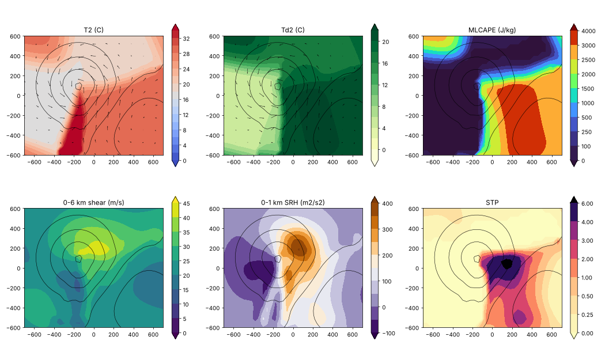

# Severe research notes

Measurements and checks behind the Severe discipline (the plan is `docs/severe-plan.md`). Newest part last. Scripts that are not part of the test suite are in
`tools/severe_research/`.

## Part 1. The real core (milestone S2a, 11 Nov 2026)

### What it is

`src/severe-core.js` is a fully compressible, non-hydrostatic cloud-model core in double precision, written to be the **reference** that the WebGPU port will be tested against, so it
favours being simple and checkable over being fast. Nothing in it is painted or fitted: it integrates the equations of motion.

- **Equations:** Klemp & Wilhelmson (1978), in perturbations about a hydrostatic base state: the winds, the potential temperature θ′ and the Exner function π′. The pressure equation
  is the exact one for dry air, with the base-state advection inside a density-weighted divergence, so a base state at rest is *exactly* at rest (no base-state pressure gradient is
  ever computed).
- **Space:** an Arakawa C grid, uniform spacing, a halo of three cells, walls (free slip, nothing through) or periodic boundaries; a 2-D slice is a grid with `ny = 1`.
- **Advection:** the 5th-order upwind-biased flux form of Wicker & Skamarock (2002), written as flux differences minus the field times the divergence of the advecting flow, so a
  constant field is never changed. One generic routine serves all four grid positions (centres, u, v and w faces).
- **Time:** their RK3; each stage integrates the fast acoustic terms (the pressure gradient and the divergence) with forward-backward small steps while the slow tendencies stay
  fixed, plus **divergence damping** (coefficient 0.1, as in WRF's `smdiv`).
- **Also in:** a constant viscosity, Coriolis (3-D), passive tracers, a stratified base state from any θ(z).
- **Not in yet:** moisture and microphysics, a sub-grid turbulence closure, open lateral boundaries, a stretched vertical grid, surface fluxes. Each is a later step of the plan.

### What was found while building it: a late blow-up, and its cure

The first version had no divergence damping. The Straka run was clean until about 800 s and then blew up (π′ from 2·10⁻³ to 0.5, winds of 400 m/s in 100 s), **but only for some
time steps**: 1 s, 3 s and 4 s survived, 1.5 s and 2 s did not; 4 times more acoustic substeps cured it. That pattern (a growth that depends on how the fast and slow steps happen to
line up) is the signature of acoustic noise that the plain forward-backward scheme does not damp. With divergence damping at 0.1 every time step from 1 to 4 s gives **the same**
answer (front 14.7 km, coldest −10.05 to −10.11 K, w up to 12.6 m/s at 200 m), which is what a correct time integration should do.

### What the tests check (`tests/severe_core.mjs`, 11 checks, 14 s)

| Check | Result |
| --- | --- |
| a stratified base state at rest stays at rest | exactly (0 in every field) |
| a tracer carried once round a periodic domain by a uniform wind | error 0.89 % at 1 km and 0.079 % at 500 m (a factor 11 for a halved grid); a constant tracer is unchanged to rounding; in 3-D (y) 0.46 % |
| a sound pulse | travels 20,710 m in 60 s against 20,761 m expected (c = 346.0 m/s): 0.25 % short, and keeps half its amplitude in each direction |
| an internal gravity wave | period 1408 s against 1405 s from ω = N k / √(k² + m²) |
| Coriolis | an inertial oscillation with u = U cos ft, v = −U sin ft, to three decimals |
| a 3-D bubble in a square box | the x-y symmetry holds to 1.4·10⁻¹⁵ |
| the Straka density current at 200 m | front between 14 and 16 km, coldest air between −11 and −8.5 K (and, with `SLOW=1`, the 100 m run agrees within 0.5 km) |

### The Straka et al. (1993) density current

A −15 K cosine bubble (4 km × 2 km, centred at 3 km height) in a neutral atmosphere of 300 K with a constant viscosity of 75 m² s⁻¹, half the domain run (the symmetry plane is a
wall), 900 s. The picture is `docs/severe-research/straka-50m.png`: the cold air falls and spreads (300 s), a head and a Kelvin-Helmholtz rotor form (600 s), and at 900 s the
front is at 14.7 km with the head's billows and the trailing rotor.

| Grid | dt | Front (−1 K on the ground) | Coldest | Largest w | Largest u |
| --- | --- | --- | --- | --- | --- |
| 200 m | 2 s | 14.70 km | −10.07 K | 12.6 m/s | 33.0 m/s |
| 100 m | 1 s | 14.72 km | −9.11 K | 12.1 m/s | 33.4 m/s |
| 50 m | 0.5 s | 14.72 km | −8.82 K | 12.1 m/s | 33.5 m/s |

The front does not move with the grid (14.70, 14.72, 14.72 km): the solution has converged in space for the front, the winds and the structure, and the coldest air is still easing
(−10.07, −9.11, −8.82 K). How much the physics matters is the viscosity: at 100 m, K = 50 / 75 / 100 m² s⁻¹ gives fronts at 14.84 / 14.72 / 14.60 km, coldest air −10.02 / −9.11 /
−8.43 K and w up to 14.4 / 12.1 / 11.2 m/s.

**Against the published solution, said plainly:** the paper's reference values are, from memory, a front at about 15 km and coldest air near −9.8 K with somewhat stronger winds; the
paper itself cannot be reached from the sandbox (WRF's open-source test case `em_grav2d_x`, reached through `raw.githubusercontent.com`, names it and uses the same settings: K = 75,
5th-order horizontal advection, divergence damping 0.1, but gives no numbers). Our front is about 2 % short and our extremes 10 to 15 % weaker, which is the size of changing K by a
quarter and is plausible from the way the diffusion is discretised, but it is **not yet checked against the paper's table**; that is the first thing to do when a copy is at hand.

### Speed

Plain JavaScript, one thread, double precision: the 200 m case (4,096 cells, 450 steps) takes about 1 s, the 100 m case (16,384 cells, 900 steps) 7 s and the 50 m case
(65,536 cells, 1,800 steps) 75 s: about 0.6 µs per cell and step in 2-D. A 3-D run costs a few times more per cell; the 1 km Weisman-Klemp storm of the next step (about 100,000 cells,
dt about 6 s) should take of the order of 0.15 s per step, a couple of hours of storm time in minutes. That is the CPU reference; the GPU port is a separate step.

### Next

Moisture (θ_v, vapour, cloud and rain with the Kessler scheme, rain fall), a sub-grid closure and the Weisman-Klemp sounding with a warm bubble: the first real storm (milestone S3).
The open-source WRF microphysics (`phys/module_mp_kessler.F` and its relatives, readable through `raw.githubusercontent.com`) is there to check constants against while the schemes are
written from the equations.

## Part 2. Moisture, and the first real storm (milestone S3, 11 Nov 2026)

### What was added to the core

- **Moist dynamics:** the buoyancy and the pressure gradient use the density potential temperature θᵥ = θ (1 + 0.608 q_v − q_c − q_r), so the weight of cloud and rain is in the buoyancy; the base state
  is hydrostatic in θᵥ; the heat released by condensation also enters the pressure equation (the expansion it causes), as a compressible model must.
- **Kessler's warm-rain scheme as in WRF's `module_mp_kessler`** (read through `raw.githubusercontent.com`; written from its equations, constants checked): rain falls with
  36.34 (0.001 ρ q_r)^0.1364 √(ρ₀/ρ) in steps short enough for a Courant number of 0.75; autoconversion 0.001 (q_c − 0.001) and accretion 2.2 q_c q_r^0.875 (implicit); rain evaporates
  in subsaturated air with Kessler's ventilation formula; one Newton step of saturation adjustment condenses or evaporates cloud. Once per step, after the dynamics.
- **Positive-definite advection of cloud and rain**, in flux form with the base-state density and the outgoing flux of every cell scaled so that it cannot give away more than it holds
  (Skamarock & Weisman 2009, WRF's `moist_adv_opt = 1`): conservative, and nothing goes negative. Why it was needed: with the unlimited 5th-order scheme, clipping the negative undershoots at
  the cloud edge **added about 15 % spurious cloud water** in a 25-minute bubble run (1.6·10⁴ kg per metre against 1.1·10⁵ kg of cloud); with the limiter nothing is clipped, and the water budget
  of that run improved from 5.4·10⁻³ to 1.7·10⁻³.
- **Damping:** a Rayleigh layer under the lid (5 km deep, 0.003 s⁻¹, as in WRF's case) and a lateral sponge, both relaxing the perturbations (and the winds towards the base-state winds).

### What the tests check (`tests/severe_moist.mjs`, 12 checks, 3 s)

| Check | Result |
| --- | --- |
| condensation conserves water and moist enthalpy | to rounding (0 and 2·10⁻¹¹ J/kg of 236) |
| one step of saturation adjustment from 3 % supersaturation | leaves the air −0.01 % from saturation |
| autoconversion and accretion | rain 0.0200 g/kg and 0.1611 g/kg, equal to the hand calculation (the fall of the cell's own rain included) |
| a rain shower falling and evaporating in dry air | the column's water budget closes to 3·10⁻¹⁶, 1.1 mm reach the ground, the heat budget to 10⁻⁶, the air cools by up to 1.7 K, nothing is clipped |
| the sounding's surface parcel (pseudo-adiabatic ascent, an independent calculation) | CAPE 2134 J/kg, condensation level 1010 m, level of free convection 1630 m, equilibrium level 11,990 m (√(2 CAPE) = 65 m/s) |
| a 3 K warm bubble in a 2-D slice of the sounding, 25 minutes | updraft 33 m/s at 22 minutes, 3.3 g/kg of cloud, first cloud at 1250 m (10 minutes), 0.3 mm of rain, water budget 1.7·10⁻³, nothing clipped |

### The first real storm: the Weisman-Klemp supercell

The set-up is WRF's `test/em_quarter_ss`: an 84 km square, 20 km deep, a 2 km grid with 500 m levels, the Weisman-Klemp (1982) sounding with its quarter-circle hodograph (the winds already
shifted so that the storm stays in the box; the file is `tools/severe_research/wk82_sounding.txt`), a +3 K bubble 10 km wide and 1.5 km deep centred at 1.5 km, no ice, a constant viscosity of
500 m² s⁻¹, periodic sides with a 10 km sponge. `tools/severe_research/wk82_run.mjs 2000 120 10 out.json 5 0` runs it (the last 0 turns ice off; since part 3 ice is the default): **two hours of storm time in two minutes** (0.17 s per 10 s step on 70,560 cells: about
2.4 µs per cell and step in 3-D with moisture). The picture is `docs/severe-research/wk82-2km.png`.

| Minute | Updraft (m/s) | Coldest air at the ground (K) | Rain water (g/kg) | Echo top (dBZ) | Vorticity 1 km / 3-5 km (10⁻³ s⁻¹) | Updraft helicity (m² s⁻²) | Updraft cores at 5 km |
| --- | --- | --- | --- | --- | --- | --- | --- |
| 15 | 19.6 | −0.5 | 4.0 | 51 | 1.8 / 4.9 | 113 | 1 |
| 25 | 36.7 | −3.2 | 15.0 | 58 | 1.9 / 7.9 | 256 | 1 |
| 35 | 40.9 | −5.2 | 16.7 | 59 | 1.0 / 9.0 | 303 | 1 |
| 45 | 36.6 | −8.3 | 16.0 | 58 | 3.7 / 7.7 | 249 | **2** |
| 60 | 44.9 | −8.7 | 15.0 | 58 | 4.1 / 8.7 | 182 | **2** (24 and 23 m/s, 14 km apart) |
| 75 | 44.4 | −8.8 | 17.4 | 58 | 5.0 / 9.4 | 232 | 4 |
| 90 | 35.5 | −9.1 | 15.9 | 59 | 5.8 / 10.7 | 372 | 4 |
| 105 | 31.1 | −10.1 | 14.6 | 58 | 3.9 / 11.9 | 85 | 2 |

What it shows, in the order of the pictures: a single cell grows to 41 m/s by 35 minutes and its cold pool spreads; between 40 and 60 minutes **a second updraft core appears and the storm splits** into a left mover
(to the north) and a right mover (to the south and east), as the quarter-circle hodograph makes it; **the right mover keeps a mid-level vorticity of 0.008 to 0.013 s⁻¹** (the usual threshold of a mesocyclone is about 0.01)
and a low-level vorticity that grows to 0.006 s⁻¹, and an updraft helicity of 250 to 370 m² s⁻² (strongly rotating storms of a 2 km model are above 75 to 100), until the storms drift into the sponge at the east edge
at about 100 minutes and decay. The cold pool of −8 to −10 K and the heavy rain (up to 66 mm) are those of a warm-rain supercell. **Gate B of the plan (it splits and rotates as published) is met qualitatively;** the
splitting at 40 to 60 minutes and the 40 to 45 m/s updraft are in the range of published simulations of this sounding (from memory, not checked against the paper).

**Said plainly:**
- *Warm rain only.* There is no ice: no anvil, no hail, no bright band, and the reflectivity from the rain mixing ratio caps near 59 dBZ (the 16 g/kg of rain is more than a real storm holds at one place).
  Ice microphysics is the next step.
- *A 2 km grid.* The echo is a large smooth blob: the hook and the rear-flank structure of clip 2 need 1 km or finer (below).
- *Viscosity, not a turbulence closure.* The constant 500 m² s⁻¹ is WRF's own setting for this case at this grid, but a 3-D closure comes later.
- *The water budget of the full run* is not a conservation test (the sponge feeds the base state in at the edges, which is what an open boundary does); the 25-minute bubble run without a sponge closes to 1.7·10⁻³.
- *Not compared with the paper's numbers:* the paper cannot be reached from the sandbox.

### The same storm at 1 km

`wk82_run.mjs 1000 120 6 out.json 5 0`: the same set-up on 282,240 cells (84 km square, 1 km grid, viscosity 250 m² s⁻¹), 767 s of CPU for the two hours (0.64 s per 6 s step: 2.3 µs per cell and step).
The picture is `docs/severe-research/wk82-1km.png`. The story is the same and sharper:

| Minute | Updraft (m/s) | Coldest air (K) | Vorticity 1 km / 3-5 km (10⁻³ s⁻¹) | Updraft helicity (m² s⁻²) | Updraft cores at 5 km (m/s at x, y km) |
| --- | --- | --- | --- | --- | --- |
| 15 | 21.7 | −0.5 | 3.2 / 11.1 | 475 | 1 |
| 25 | 37.3 | −4.0 | 2.2 / 17.8 | 890 | 1 |
| 35 | 55.8 | −6.4 | 5.1 / 16.9 | 670 | 1 |
| 45 | 48.6 | −7.1 | 8.7 / 19.6 | 510 | **2**: 34 at 50, 42 and 29 at 43, 50 |
| 55 | 49.2 | −8.1 | 7.1 / 22.4 | 469 | 2: 34 at 54, 41 and 27 at 45, 52 |
| 65 | 51.2 | −8.7 | 9.1 / 20.9 | 496 | 2: 35 at 58, 39 and 26 at 48, 57 |
| 85 | 43.1 | −10.1 | 9.8 / 17.3 | 524 | 4 (the right mover at 66, 35) |
| 105 | 43.5 | −8.8 | 8.2 / 13.0 | 434 | 4 (the right mover at 75, 39, at the sponge) |

The updraft is stronger (56 m/s at 35 minutes), the split happens a little earlier (at about 45 minutes), the mid-level vorticity of the right mover is 0.017 to 0.022 s⁻¹ and its low-level vorticity 0.007 to
0.010 s⁻¹ (a strong low-level mesocyclone), the updraft helicity 380 to 890 m² s⁻², and the right mover is followed for 60 minutes as it moves south-east from (50, 42) to (75, 39) km. The echo is notched on its
south-west side at 45 and 60 minutes, the first sign of the rear-flank structure of a supercell; **a hook echo proper needs 500 m and ice**, and the rain is still capped at 59 dBZ.

## Part 3. Ice, and the first comparison with real radar (milestone S4, 11 Nov 2026)

### What was added to the core

A single-moment ice scheme of the Lin et al. (1983) / Rutledge & Hobbs (1984) / WSM6 class with five species: cloud water, rain, **cloud ice, snow and graupel** (`ice: true` in `create`; the sizes of the
precipitating species are exponential distributions, N(D) = N₀ e^(−λD), and the mixing ratio fixes λ).

| Species | N₀ (m⁻⁴) | Density (kg/m³) | Fall speed a D^b √(ρ₀/ρ) |
| --- | --- | --- | --- |
| rain | 8·10⁶ | 1000 | 842 D^0.8 (Liu & Orville) |
| snow | 2·10⁶ exp(0.12 (T₀ − T)), at most 2·10⁸ | 100 | 11.72 D^0.41 (Locatelli & Hobbs) |
| graupel (the default) | 4·10⁶ | 400 | a drag law, C_D = 0.6, b = 0.5 |
| graupel as "hail" (`iceParams: { n0g: 4e4, rhog: 900 }`) | 4·10⁴ | 900 | the same law, denser |
| cloud ice | one size from n_i = 5.38·10⁷ (ρ q_i)^0.75 | 500 | 3.29 (ρ q_i)^0.16 |

The processes, in the order they are applied to a cell once per step (each limited by what it can take): sedimentation of rain, ice, snow and graupel (upwind, Courant number 0.75, the flux at the ground is
precipitation and is counted by species); melting (cloud ice at once; snow and graupel by the heat the air conducts and the vapour it carries to them, Q = K_a (T − T₀) + L_v D_v ρ (q_v − q_s(T₀)), with the
ventilation factor of Hall & Pruppacher; limited by the heat in the air, so a long step never cools the air below freezing); homogeneous freezing at −40 °C (cloud water to ice, rain to graupel); freezing of rain
(Bigg 1953, in the form of Lin et al.: 20π² B′ N₀ᵣ (ρ_w/ρ) (e^(A′ ΔT) − 1) / λ⁷ with B′ = 100 m⁻³ and A′ = 0.66 K⁻¹); riming (snow and graupel sweep up cloud water, which freezes onto them); graupel
collecting rain and snow; snow and graupel collecting cloud ice; ice to snow above 0.5 g/kg and snow to graupel above 0.6 g/kg; Kessler's autoconversion and accretion of cloud water to rain as before; ice
nucleation (Cooper 1986, 5 e^(0.304 ΔT) crystals per m³ below −5 °C); deposition and sublimation on ice, snow and graupel by diffusion theory with ventilation (the Bergeron process is not coded: it comes out of
ice drying the air below water saturation, after which the saturation adjustment of cloud water evaporates the cloud); rain evaporation. **Every process moves mass with its latent heat** (condensation L_v, freezing and
melting L_f, deposition and sublimation L_s = L_v + L_f), so water and the moist enthalpy c_p T + L_v q_v − L_f (q_i + q_s + q_g) are conserved by construction. The heat of every process also enters the pressure
equation as the expansion of a gas, as in part 2. `ice: false` (the default) is the warm-rain core of part 2, untouched.

**One thing in the textbook scheme was wrong enough to change.** The collection of one species by another (graupel collecting rain or snow) is an integral of the collision kernel
(π/4) (D_x + D_y)² |V_x − V_y| over both size distributions. Lin et al. expand (D_x + D_y)² into three terms and take **one mean fall speed for each distribution** for the whole integral, the difference of two numbers
that are close when graupel and rain fall at about the same speed. For 1 g/kg of graupel and 1 g/kg of rain at −10 °C the mean speeds are 5.2 and 6.1 m/s, but the collisions are carried by the large drops (the
integral weights a drop by D⁵) at about 8 m/s and the small graupel (most of the number) at about 2 m/s: **the double integral over both distributions with the fall speed of every size is 5.5 times the closed form**
(a scratch check, then the test below). Each of the three terms now uses the speed each distribution has under that term's own weight, V(p) = a Γ(1 + p + b) / Γ(1 + p) / λ^b: the closed form is then
**0.98 times the double integral for rain and 0.84 for snow**. (WRF's `module_mp_lin.F` uses `abs(vtr − vtg)` of the mass-weighted mean speeds, as Lin et al. wrote it.) It changed the storm very little: in the Weisman-Klemp storm the rain is frozen by Bigg's process
before the graupel can collect much of it.

### What the tests check (`tests/severe_ice.mjs`, 31 checks, 8 s)

| Check | Result |
| --- | --- |
| 300 random states from −48 to +9 °C, every species present or not, dry to supersaturated: one step of every process | water conserved to 7·10⁻¹⁸ kg/kg, the moist enthalpy to 1.2·10⁻¹⁰ J/kg of 3·10⁵, nothing negative |
| snow in air 3 K above freezing | 2.0 g/kg of snow melts to 1.6 g/kg of rain in a minute and cools the air by 0.6 K, never below freezing, water and enthalpy conserved; the melt rate equals the **quadrature of the size distribution** (38.85 mg/kg in 1 s against 38.85); a 600 s step in air 0.05 K above freezing melts only what the air can pay for |
| snow at −2 °C in ice-saturated air | does not melt |
| riming of 1 g/kg of cloud water by 1 g/kg of snow at −10 °C | 60.5 mg/kg in 10 s against 52.8 by hand (the Bergeron growth takes a little more); the water freezes and warms the air |
| the Bergeron process at −15 °C | snow grows from 0.20 to 0.53 g/kg and cloud water falls from 0.50 to 0.16 g/kg in 5 minutes, water conserved to 10⁻¹⁸ |
| deposition on 0.1 g/kg of snow, 15 % over ice at −15 °C | 0.146 mg/kg in 1 s, **equal to the quadrature of the size distribution with diffusion theory** (the excess would be used up in 33 minutes); 1 g/kg of snow brings the air to ice saturation in 40 minutes without overshooting; a 600 s step stops at saturation |
| Bigg freezing | 43.25 mg/kg in 0.1 s against 43.20 by hand (0.30 per second of the rain at −20 °C); rain at −20 °C is graupel within 10 s; rain at −3 °C mostly stays rain |
| homogeneous freezing | cloud water freezes at −45 °C (and warms the air by 0.33 K) and survives at −35 °C; rain at −45 °C becomes graupel (not snow) and warms the air by L_f/c_p per kg |
| snow collecting cloud ice | 4.14 mg/kg in 10 s against 4.14 by hand; heavy snow (2 g/kg) turns to graupel, light snow (0.5 g/kg) does not |
| graupel collecting rain and snow | 0.98 and 0.84 times the double integral over both size distributions |
| ice nucleation | 3.12·10⁻⁹ kg/kg at −20 °C, **equal to Cooper's rate by hand**, 20 times more at −30 °C, none at −3 °C |
| the heat of freezing in the pressure equation | the pressure perturbation after freezing 1 g/kg of cloud water is C_c ρ Δθ: 4.189·10⁻⁴ against 4.188·10⁻⁴ by hand |
| fall | graupel 5.1, snow 1.2 and cloud ice 0.66 m/s (3.29 (ρq)^0.16 gives 0.69); the hail setting 11.7 m/s; a 60 s step (Courant number 1.4) is split into stable sub-steps |
| the water budget of three columns for 2.5 hours (air, vapour included, plus what reached the ground, against the start) | closes to 5·10⁻¹⁴ of the water put in; 93 % reaches the ground (the cloud ice melts to cloud water, which stays up); a column below freezing all the way delivers its graupel to the ground as graupel, none as snow |
| a 2-D warm bubble in the Weisman-Klemp sounding, 40 minutes | stable; updraft 36.7 m/s, graupel up to 14 g/kg, cloud ice 1.1 g/kg, ice up to 13.75 km, 12 mm of rain, water budget 2.4·10⁻³, nothing clipped to speak of (8·10⁻¹¹ of the water) |

**Mutation testing** (`tools/severe_mutants.mjs`, 38 one-expression changes of the scheme, each run against `severe_ice.mjs` and `severe_moist.mjs`): the first run killed 25 and **12 survived** (the melt
limit and rate, rain freezing to snow instead of graupel, graupel collecting rain, snow collecting ice, the snow-to-graupel threshold, the limit on deposition, Cooper's rate and its switch, the fall speed of
cloud ice, the hail accounting, the pressure term): each was a place the tests did not look. The tests above that quadrature, hand or budget checks were written for them; now **all 38 are killed**.

### The storm with ice

`wk82_run.mjs 2000 120 10 out.json` (ice on by default; `... 1 4e4 900` is the hail setting, `... 0` the warm rain of part 2) writes the maps, two vertical slices through the strongest updraft and the whole 3-D
reflectivity of every frame. **The reflectivity is the Rayleigh value at 10 cm as WRF's `refl10cm_lin` computes it**: rain 720 N₀/λ⁷, snow and graupel as ice spheres of their density with the dielectric factor
0.176/0.93 against water, rising to 1 as the ice gets wet (a water coat on a quarter of the mass reflects like rain) in the way down from the freezing level; cloud ice is ignored. Ice costs **about 1.5 times the
warm-rain core**: 4.8 against 3.2 µs per cell and step on one core (2 hours of the 2 km storm in 3 minutes 40 seconds). The picture is `docs/severe-research/wk82-ice-2km.png`.

| Minute | Updraft (m/s) | Coldest air (K) | Rain / cloud ice / snow / graupel (g/kg) | Strongest echo (dBZ) | 10 dBZ top (km) | Ice water path (kg/m²) | Vorticity 1 km / 3-5 km (10⁻³ s⁻¹) | Updraft helicity (m² s⁻²) | Updraft cores at 5 km |
| --- | --- | --- | --- | --- | --- | --- | --- | --- | --- |
| 15 | 19.9 | −0.4 | 3.6 / 0.0 / 0.00 / 3.9 | 51 | 7.0 | 4 | 1.8 / 4.9 | 114 | 1 |
| 25 | 45.3 | −3.2 | 8.5 / 0.9 / 0.05 / 14.8 | 57 | 13.5 | 39 | 1.9 / 7.9 | 276 | 1 |
| 35 | 50.9 | −4.3 | 8.6 / 0.9 / 0.11 / 16.5 | 58 | 15.5 | 59 | 1.1 / 8.7 | 288 | 1 |
| 45 | 46.2 | −7.3 | 6.5 / 1.0 / 0.14 / 14.9 | 59 | 15.5 | 59 | 3.0 / 7.7 | 256 | 1 |
| 60 | 45.6 | −9.6 | 6.6 / 1.0 / 0.30 / 14.5 | 56 | 15.0 | 59 | 4.6 / 8.1 | 218 | **4** (26 at 53, 53 and 22 at 57, 41) |
| 75 | 51.4 | −10.4 | 7.4 / 1.1 / 0.18 / 16.2 | 57 | 15.5 | 61 | 4.6 / 9.0 | 284 | 4 (27.8 at 69, 37) |
| 90 | 39.0 | −9.3 | 7.5 / 0.8 / 0.17 / 14.0 | 58 | 15.0 | 61 | 5.6 / 9.8 | 177 | 4 (24.6 at 75, 33) |
| 105 | 31.3 | −9.4 | 6.3 / 0.8 / 0.07 / 11.8 | 56 | 14.5 | 45 | 3.0 / 6.4 | 125 | 3 |

Against the warm-rain storm of part 2 (same grid, same sounding): **the updraft is stronger** (45 to 51 m/s against 37 to 45: freezing releases 3.3·10⁵ J/kg, about 13 % of the heat of condensation per kilogram, above
the freezing level), **there is an anvil and a deep echo** (the 10 dBZ top reaches 15 to 15.5 km, the tropopause being at 12; the vertical slices show a core of 55 dBZ and more from 1 to 10 km under an anvil
spreading downwind between 10 and 14 km, an overshooting top, and the 0 °C and −40 °C isotherms at 3.8 and 9.7 km), the storm splits at the same time and the right mover keeps its rotation (vorticity at 3 to 5 km
of 0.008 to 0.010 s⁻¹, helicity 180 to 290), and the cold pool at maturity is about the same (−9 to −10.5 K against −8.5 to −10).

**How much the one free choice of the scheme matters** (the same storm, 2 km, minutes 40 to 100 unless said):

| Graupel / hail setting | Updraft (m/s) | Strongest echo (dBZ) | Coldest air (K) | Graupel / snow (g/kg) | Most precipitation at the ground (mm) |
| --- | --- | --- | --- | --- | --- |
| warm rain only (part 2) | 45 | 59 | −10.1 | | 66 |
| **graupel, N₀ 4·10⁶, 400 kg/m³ (the default)** | 53 | 59 | −10.6 | 17 / 0.3 | 41 |
| N₀ 4·10⁵, 700 kg/m³ | 50 | 65 | −12.0 | 18 / 0.6 | 68 |
| hail, N₀ 4·10⁴, 900 kg/m³ | 51 | 74 | −14.7 | 24 / 2.5 | 112 (26 as hail) |

The dynamics are about the same; the **reflectivity differs by 15 dBZ** (Z ∝ N₀^(−3/4) q^(7/4) for a given mass, so a hundredfold N₀ is 15 dB), the cold pool by 4 K, and the precipitation at the ground by a factor 2.7
(small graupel melt and evaporate more on the way down and big hail does not), which no radar comparison can constrain and a rain-gauge one could. The next section chooses between them.

### The same storm at 1 km

`wk82_run.mjs 1000 120 5 out.json`: 282,240 cells (viscosity 250 m² s⁻¹), 26 minutes of CPU for the two hours with another run on the machine (about 4 µs per cell and step). The picture is
`docs/severe-research/wk82-ice-1km.png`.

| Minute | Updraft (m/s) | Coldest air (K) | Rain / cloud ice / snow / graupel (g/kg) | Strongest echo (dBZ) | 10 dBZ top (km) | Vorticity 1 km / 3-5 km (10⁻³ s⁻¹) | Updraft helicity (m² s⁻²) | Updraft cores at 5 km |
| --- | --- | --- | --- | --- | --- | --- | --- | --- |
| 15 | 22.1 | −0.4 | 5.9 / 0.0 / 0.00 / 6.2 | 55 | 7.5 | 3.3 / 11.2 | 486 | 1 |
| 25 | 44.9 | −4.1 | 9.7 / 0.9 / 0.10 / 14.5 | 58 | 13.5 | 2.2 / 18.3 | 904 | 1 |
| 35 | 61.8 | −4.7 | 9.0 / 1.2 / 0.12 / 17.0 | 58 | 15.5 | 3.2 / 16.2 | 638 | 1 |
| 45 | 58.9 | −8.5 | 7.9 / 1.0 / 0.21 / 18.5 | 58 | 16.0 | 9.5 / 19.2 | 705 | **3** (34.6 at 49, 42 and 31.5 at 44, 51) |
| 55 | 57.0 | −9.1 | 8.4 / 1.1 / 0.17 / 15.4 | 59 | 15.5 | 8.4 / 19.8 | 615 | 3 (31.4 at 54, 42 and 28.4 at 52, 54) |
| 65 | 57.3 | −9.5 | 7.7 / 1.4 / 0.17 / 15.0 | 57 | 15.5 | 8.2 / 21.6 | 660 | 4 (34.8 at 59, 40 and 31.8 at 55, 57) |
| 85 | 56.1 | −10.3 | 6.4 / 1.1 / 0.22 / 14.6 | 56 | 14.5 | 7.8 / 19.5 | 491 | 4 (34.3 at 68, 37) |
| 105 | 39.0 | −9.3 | 7.5 / 0.8 / 0.21 / 12.3 | 56 | 14.0 | 7.0 / 14.4 | 167 | 4 |

Against the warm-rain storm at 1 km (part 2): the updraft peaks at **63.8 m/s** (55.8), the updraft helicity at **1356** (1005), the mid-level vorticity at 0.027 s⁻¹ (0.024) and the low-level vorticity is the same
(0.011 s⁻¹); the cold pool is −10.7 K (−10.25), the echo top 16 km and the strongest echo 60 dBZ. The plan view at 45 minutes has the notched, asymmetric shape of a supercell with the core on the west flank, where the
updraft is, and at 75 minutes several cores. **The comparison with real radar does not change with the grid:** the 1 km run, averaged to 2 km columns, is within 1 dB of the 2 km run in the 90th and
99th percentiles below 10 km and within 2.2 dB above it, in both storms (table below).

### The first comparison with real radar

`tools/severe_research/nexrad_cfad.py` (Py-ART, which is not a dependency of the project and was installed in a scratch directory) reads **real NEXRAD Level II volumes** from the Unidata archive
(`s3://unidata-nexrad-level2`, public) and compares their reflectivity by height with the model's. The comparison is made the way the radar sees: a volume cuts a storm 120 km away at 13 or 14 heights only, with a
beam 2 km thick, so the **model is sampled by a virtual radar at the same range** (at every elevation of the real volume the model's linear Z is averaged over the beam's vertical extent, centre r sin e + r²/(2·4/3·R_E)),
and the real gates are averaged (in linear Z, a gate with no echo counting as none) into 2 km columns, the model's own size. A column is part of the storm when any beam sees 20 dBZ or more in it; the box is the
model's 84 km square, centred on the strongest cluster of 55 dBZ. Two real storms, four volumes each:

- **KOAX (Omaha), 16 June 2014, 22:16 to 22:43 UTC:** the storms 113 to 124 km north of the radar (42.3 to 42.4°N, 96.5 to 96.7°W), one of them with a cyclonic velocity couplet of 28 m/s across 2 km in the dealiased lowest sweep of 22:37.
- **KSGF (Springfield, Missouri), 22 May 2011, 21:41 to 22:15 UTC:** **the Joplin supercell**, at 112 to 131 km (its EF5 tornado began at about 22:34, from memory).

The model is the 13 frames from minute 40 to 100 of the three settings above and of the 1 km run (averaged to 2 km columns). The picture of each storm is `docs/severe-research/cfad-koax-2014.png` and `cfad-ksgf-2011.png`: the median, 90th and 99th percentile of
the reflectivity of the storm columns by height, thin lines the volumes, thick lines the model (a band for the 10 to 90 % of its frames), the share of the columns with 20 dBZ or more (the echo depth), and the pooled
frequency by height of the real storm and of each setting.

| Model minus real (dB), mean over the beam heights of the layer | Storm | median 2-10 km | 90th | 99th | median 10-15 km | 90th | 99th |
| --- | --- | --- | --- | --- | --- | --- | --- |
| hail, N₀ 4·10⁴, 900 | KOAX | +14.0 | +16.8 | **+14.6** | +10.1 | +15.6 | +11.5 |
| | KSGF | +6.1 | +12.6 | **+10.8** | +10.3 | +21.4 | +15.5 |
| N₀ 4·10⁵, 700 | KOAX | +14.9 | +11.6 | +6.2 | +12.5 | +13.9 | +6.4 |
| | KSGF | +8.0 | +7.7 | +2.7 | +12.1 | +17.8 | +10.1 |
| **graupel, N₀ 4·10⁶, 400 (the default)** | KOAX | +13.3 | **+5.5** | **−1.4** | +10.5 | +7.2 | −1.4 |
| | KSGF | +6.8 | **+0.9** | **−5.4** | +10.6 | +11.4 | +2.2 |
| graupel at 1 km (the default) | KOAX | +14.3 | +4.7 | −2.3 | +7.4 | +5.0 | −2.0 |
| | KSGF | +7.3 | +0.1 | −6.4 | +10.0 | +10.1 | +1.4 |

What it says:
- **The hail setting is 11 to 17 dB too reflective at the top of the distribution in both storms**, from different radars, years and environments (the model's 99th percentile is 67 to 70 dBZ from 2 to 10 km
  where the real storms' is 51 to 61). **The graupel of Lin et al. is within about 5 dB of the 99th percentile everywhere and of the 90th below 10 km**, and that is why it is the default.
- **The weak echo is not right with any setting.** The median of the storm columns is 6 to 15 dB too high and the share of columns with 20 dBZ or more at 10 to 12 km is 18 to 30 points too high (34 % real against 63 % at 11.4 km for KOAX, 54 against 72 and 31 against 52 for KSGF at 10 and 12 km): **the real
  storms have far more weak echo around the strong cores** (the real frequency peaks at 15 to 25 dBZ at every height, the model's is flat), and **the model's anvil is too deep and too reflective at 10 to 14 km**.
  The anvil is graupel carried up by the updraft and rain frozen at −40 °C (in the vertical slices 99 % of the cells of 20 dBZ or more at 10 to 14 km hold more graupel than ice and snow, 6 g/kg against
  0.45); in a real anvil the crystals aggregate into snow, which the scheme turns into graupel as soon as there is graupel to collect it (snow reaches 0.3 g/kg at most, against 1 to 2.5 g/kg with the hail setting). The extremes are compressed too: the model's maximum is 1 dB over its 99th
  percentile, the real storms' 1 to 4 dB.
- **Gate C (a CFAD in range) is met in part:** for the strong echo (90th and 99th percentile, 2 to 10 km) of two real supercells, with the graupel setting; **it is not met for the weak echo and the anvil
  (10 to 15 km), nor for the median**. Two storms, one idealised environment and a hail-or-graupel choice that is a tuning of a single-moment scheme are not a validation; the plan's two-moment hail (S8) is the
  principled answer, and real days with their own soundings (S10) the proper test.

### Said plainly
- *No bright band in these storms.* The wet-ice rule is in the reflectivity diagnostic, but a bright band belongs to stratiform rain, which a supercell does not have; it will be tested on a squall line's trailing
  region (S10) and in a column test of the radar operator (S0).
- *A single-moment scheme has no sizes.* The mixing ratio fixes the size of the stones; **there is no hail size and no hail swath** until the two-moment scheme (S8), and the 41 to 112 mm of precipitation at the
  ground depend on the setting.
- *The cold pool is probably too strong* (−9 to −10.5 K at the ground, against the few kelvin that supercell outflows measure, from memory and not checked here): the usual fault of single-moment rain.
- *Reflectivity is Rayleigh at 10 cm* with no attenuation, no beam smoothing in the maps, no melting-snow bright band, cloud ice ignored.
- *The real storms are two,* from the days I could name (a supercell day in Nebraska and Joplin); the environments differ from the idealised Weisman-Klemp one (CAPE 2134 J/kg), no sounding of those days was used, and
  the real volumes sample the storm only from 1.8 to 2.2 km up (nothing below).
- *The velocity at tilts with the fall speed* and the CFAD of the radar operator belong to S0 (the operator), not to the core.

### Next
The recorded storms are the input of the radar app (S0: the operator, which adds the beam, the gates and the speckle of part 2's list of things a radar does); the GPU port (S2b) makes them live; two-moment
rain, graupel and hail (S8) answer the hail size and the anvil.

## Part 4. The radar's view, your colour table and the large end (milestone 36, 11 Nov 2026)

You asked for four things: a radar picture of a higher quality (gates as small as on a real radar, matched to image examples), your colour table (`Apocs_BR_Expert.pal`) as the palette, the
colours interpolated, and the large-end scenarios tested first. The pictures are `docs/severe-research/radar-extremes.png`, `radar-real-vs-model.png`, `radar-palette.png` and `radar-ramp.png`.

### What was added
- `src/severe-palette.js`: reads a GRLevelX colour table (`Color:` with one or two colours, `SolidColor`, `Color4`, comments) and builds a look-up table (every 0.05 dBZ). Your file is kept as
  `data/severe/Apocs_BR_Expert.pal`.
- `src/severe-radar.js`: the **operator** (`scan`: a model volume of reflectivity becomes one tilt of gates, 250 m by 0.5°, the first gate at 2125 m, 920 gates (230 km) or up to 1840 (460 km)) and the
  **renderer** (`render`: every pixel asks which gate it is in and takes that gate's colour; the gates are blocks, nothing is smoothed, zooming makes them bigger). No browser, no page yet.
- `tests/severe_radar.mjs`: **35 checks** (27 s, in `npm test`); and two more checks in `tests/severe_moist.mjs` (14 in all) for the moister soundings.
- `tools/severe_radar_mutants.mjs`: **45 mutants** (all killed), each one expression of the operator, the renderer or the colour-table reader changed, run against that test. The first run let 11 through and each was a
  real gap: the tests now count the empty sky and the clutter beyond 50 km exactly, look at an echo edge half a beam-sigma beside the ray (0.726 and 0.274 of the power for the three-point rule, 0.667 and
  0.333 if its weights were equal), compare the ground range with the standard formula, look at a beam along the ground (the part of the beam under the ground sees nothing: a uniform 40 dBZ field reads 38.9 dBZ), check that pixels are opaque, that a table given out of order is sorted and that the look-up table has the
  right size and takes the nearest entry. Three lines that did nothing (a second ground check, two redundant tests in the colour look-up) were removed from the code instead.
- In `tools/severe_research/`: `radar_render.mjs` (a recorded storm to a PNG), `radar_real_render.mjs` and `nexrad_sweep.py` (a real NEXRAD sweep drawn with the same renderer and palette),
  `radar_testcard.mjs` (a test card of the table, and a ramp up to 105 dBZ through the whole operator), `wk82_cape.mjs` (the CAPE of a sounding), `png.mjs`.

### The colour table and its interpolation
27 entries from -35 to 100 dBZ. A line with two colours (only the one at -2 dBZ has them) is a segment that starts with the first and ends, at the next entry's value, with the second; a line with one
colour runs to the next entry's colour. Between entries the colour is a **straight line in red, green and blue**; where the file has two colours at a place there is a jump, and the only one in your
file is at 12 dBZ (31,154,180 to 0,166,169). The look-up table has 2901 entries; the largest step between neighbours is 6 of 255 in any channel and there is that one jump. Below -35 nothing is
drawn (the background shows), a value that is not a number draws nothing, and above 100 the last colour stays. `radar-palette.png` shows the bar as drawn, the same entries held flat for comparison, and
the three colour channels; `radar-ramp.png` is a storm whose reflectivity rises from 0 to 105 dBZ along 120 km, seen through the whole operator: teal, green, yellow, orange, red, magenta, then black at
69, white at 75, cyan at 80, blue at 90 and 95 and black at 100, with the speckle on top.

### The operator, and what real radars say about it
Geometry (a 0.5° beam is 1.46 km up at 100 km and 4.10 km at 200 km), the Gaussian beam of 0.9° (nine points up it, three across, in power, the ground cutting off what is under it), the speckle of N = 2
independent samples (a spread of 3.49 dB, a mean 1.25 dB under the true value), 0.5 dBZ steps, random numbers seeded by (frame, radial, gate). All of that has a closed-form check (part of the 35).
What a model does not make, a radar sees: **the noise floor, the receiver's threshold, ground clutter, the clear-air return of insects and the odd isolated target.** Those were first set by eye and the
first pictures were wrong in a way a real radar settles: a wash of light-grey noise at 100 to 200 km and a clear air of sparse blocks. So they were measured. The lowest tilt of **14 real volumes**
(KOAX 16 June 2014, KSGF 22 May 2011, KTLX 20 May 2013; Level II from the Unidata archive, Py-ART, `nexrad_sweep.py`) says:

| range (km) | 40-60 | 80-100 | 140-160 | 240-260 | 340-360 | 420-440 |
| --- | --- | --- | --- | --- | --- | --- |
| lowest value of the bin, 14 real volumes (dBZ) | -9.0 | -2.5 | 3.0 | 9.0 | 13.0 | 17.0 |
| the same, the simulated receiver (a uniform -22 dBZ echo) | -10.0 | -3.0 | 3.0 | 9.5 | 14.5 | 17.5 |

The floor follows **-41.8 dBZ at 1 km + 20 log r + 0.019 dB per km** (the last term is the correction for the air's attenuation that the radar applies, and it is what makes the floor rise faster than the
square of the range: 7 dB between 50 and 430 km); the guess made first (-59 dBZ at 1 km, no range term) was 17 dB too sensitive. The **clear air** is a continuous return in the boundary layer, not
sparse targets: the real radars report 99 % of the gates out to 45 km (KOAX). It is set to +2 dBZ at the antenna (it varies from a dull day, -4.7 dBZ at KSGF, to a day of insects, +4 at KOAX), a spread
of 5 dB (two sizes of patches, 9 and 2.8 km, and the speckle), a layer 1.3 km deep with a soft top (so it ends where the beam leaves it, 80 to 100 km away at 0.5°), 1.5 dB lower per kilometre of height.

| clear air, 0.5° tilt (gates with no 18 dBZ echo near them) | 5-15 km | 25-35 km | 55-65 km | 85-95 km |
| --- | --- | --- | --- | --- |
| share of the gates that report, KOAX / KSGF / simulated | 99 / 99 / 100 % | 99 / 90 / 99 % | 87 / 31 / 89 % | 37 / 10 / 40 % |
| spread of the reported values, KOAX / KSGF / simulated (dB) | 5.2 / 5.7 / 5.0 | 4.2 / 5.2 / 4.6 | 3.4 / 3.0 / 4.1 | 2.4 / 2.3 / 2.3 |
| neighbouring gates differ by (÷ √2), KOAX / KSGF / simulated (dB) | 3.5 / 3.6 / 4.1 | 3.2 / 3.7 / 3.5 | 2.7 / 2.5 / 2.9 | 2.1 / 1.9 / 2.1 |

`tests/severe_radar.mjs` holds the simulated numbers between the two real radars (with a little slack), the floor within 2 dB of the real one at six ranges, and the clear air gone beyond 140 km.
`radar-real-vs-model.png` is the same renderer and the same colour table on a real sweep (KTLX, the Moore supercell; KOAX clear air) and on the simulated one, at the same scale.

### The large end
**Found by the first extreme storms, and it was not the core:** the pictures of a storm with a CAPE of 5557 J/kg showed a frame of strong echo along the edge of the box and rain over the whole box from the
first minutes. The cause was the script that makes the moister soundings: it multiplied the vapour by 1.15 or 1.35 below 3 km with no limit, which makes the air **102-108 % saturated between 1 and 3 km
(scale 1.15) and 100-127 % (1.35)**; the model condensed all of it at once and the box rained (22-26 dBZ at the ground, everywhere, at minute 10). `loadSounding` now never goes beyond 95 % relative humidity
at any level (or beyond what the profile had); the CAPE is the surface parcel's and hardly changes. Three storms were run again at 2 km (84 km box, 90 minutes):

| storm | CAPE (J/kg) | strongest updraft (m/s) | 10 dBZ echo top (km) | strongest echo (dBZ) | updraft helicity max | coldest air at the ground (K) | rain at 90 min (mm) |
| --- | --- | --- | --- | --- | --- | --- | --- |
| the Weisman-Klemp storm (part 3) | 2134 | 45-51 | 15-15.5 | 55-59 | | | |
| moister, graupel | 3603 | 51.5 | 16.0 | 59 | 380 | -9.2 | 50 |
| moister still, graupel | 5640 | 64.9 | 17.0 | 60 | 559 | -10.6 | 64 |
| moister still, "hail" setting | 5640 | 60.3 | 16.5 | 77 (70 at 1 km) | 551 | -14.3 | 157 |

The far field is now empty and the edge frame is gone (the model's composite reflectivity at 10 to 75 minutes: one storm that moves east and has split into several cells by 75 minutes). The updrafts
reach about 60 % of the parcel speed, sqrt(2 CAPE) = 85 and 106 m/s. A larger CAPE hardly changes the graupel storm's reflectivity (59 and 60 dBZ), it makes it taller and stronger; the 70s dBZ come from the hail setting
(11-17 dB too reflective against real storms, part 3): **a stress test of the palette's top end, not a calibrated hail.** `radar-extremes.png` shows both at 0.5°, the storm complex at 75 minutes
(77 dBZ gates: black pixels at 69, white at 75), a 3.1° tilt (the beam 4 km up over the core), a storm 195 km away (the beam 4.4 km up and 1.7 km wide: the gates are tall bars) and a radar 25 km from
the core.

What the operator does at the large end, as checks: a 100 dBZ echo is seen as 99.3 dBZ on average with nothing lost to overflow and a colour in the table; a volume of NaN, +∞ and -∞ gives gates that are
numbers or no data and does not stop the scan; out to 460 km the scan runs (a shower 3 km deep is seen from 60 km and not from 400 km, where the 0.5° beam is 12.9 km up: far storms lose their lowest
kilometres); a full sweep (720 radials by 920 gates, the nine-point beam) takes 0.5 to 1.5 s on this machine and a 1920 by 1080 picture 0.05 to 0.2 s, so a frame can be drawn and its radar re-sampled
while the slider moves; a picture of three gates has exactly their three colours.

### Said plainly
- *The model storms are smooth.* At 2 km a storm has no hook, no debris, no sharp edge: the real supercell in `radar-real-vs-model.png` has all three. The pixel texture matches; the structure is the model's.
- *The clear-air level is one setting.* Real radars run from -5 to +5 dBZ with the day and the season (night, winter and a dry day are different); the default is a summer afternoon between the two radars measured.
- *Ground clutter is by eye* (30 % of the gates at the radar, falling off over 12 km, -10 to +20 dBZ): the real radars were measured for their clear air and their floor, not for their clutter,
  and there is no beam blockage, no anomalous propagation, no sidelobe, no range weighting along the pulse.
- *The floor and the clear air rest on 14 volumes at three sites* (three afternoons of severe weather; the clear air is the part of each sweep with no weather in it); a site's own sensitivity differs by a few dB.
- *The velocity product is not built.* It needs the three wind components recorded with the reflectivity (the recorder writes reflectivity only), and then the fall speed and the aliasing. (Built in milestone 37: part 5.)
- *The radar sees only the box.* The storms are an 84 km box; the far-range pictures show the part of the sky the box holds and nothing beyond.

### Next
The recorder writes u, v and w, the operator gets velocity (with aliasing: both done in part 5), and the radar page (panes, the three themes, colour bars, the site pill, the frame slider with 1, 3, 5 and 10 game minutes)
is built on them; the GPU port makes the runs live.

## Part 5. u, v and w, and the Doppler velocity (milestone 37, 11 Nov 2026)

You asked to work on u, v and w now, with velocity. The model always had the winds; what was missing was keeping them (the recorder wrote reflectivity only), the fall speed of the rain, and a radar that measures
them. The pictures are `docs/severe-research/radar-velocity-winds.png`, `radar-velocity-storm.png`, `radar-velocity-real-vs-model.png`, `radar-velocity-clearair.png` and `radar-velocity-statistics.png`.

### What was added
- **The recorder** (`tools/severe_research/wk82_run.mjs`) writes for every frame the three winds at the cell centres (the C grid's face values averaged, 0.01 m/s in an Int16 file, `<run>.wind3d.i16`), and the
  **reflectivity-weighted fall speed** of the precipitation (0.25 m/s, `<run>.vz3d.u8`); the run's JSON has the **motion of the box over the ground** (8.10 m/s east, 4.94 north) and the **base-state winds** (for the air
  outside the box). The Weisman-Klemp hodograph starts calm at the ground, so the frame in which the storm stays in the box moves at minus its surface wind: the radar, standing on the ground, sees the
  model's winds *plus* that motion, and over a 90-minute run it drifts 44 km west and 27 km south through the box (`radar0=` in `radar_render.mjs` puts it there). A 1 km, 90-minute run has 32 MB of winds,
  a 2 km, 120-minute run 11 MB. `tools/severe_research/frames.mjs` reads a frame back as a volume in the ground's frame.
- **The fall speed** (`core.zFall` in `src/severe-core.js`): a radar sees the fall of the drops that reflect, the sixth moment of the size distribution, not the mass-weighted fall the model uses to move water.
  For the model's exponential distributions with a fall speed a D^b it is a Gamma(7 + b) / Gamma(7) / lambda^b: for 1 g/kg at 5.25 km **9.75 m/s for rain against 6.18 m/s by mass**, 1.61 for snow, 7.17 for
  graupel, 17.28 for hail, nothing where there is no water. `tests/severe_ice.mjs` compares each species with a numerical integral of its size distribution (33 checks, two new).
- **The operator** (`scan(volume, { velocity: true })` in `src/severe-radar.js`) adds a radial velocity and a spectrum width to every gate that has an echo; **`render(sweep, lut, { field: 'vel' | 'sw', scale })`**
  draws them as blocks with **your velocity table** (`data/severe/User_BV_mph.pal`, below) and a placeholder table for the width (`Isobar_SW_placeholder.pal`); a velocity in m/s is multiplied by
  the table's unit first (`HFSeverePalette.unitScale`: 2.237 for miles per hour, 1.944 for knots, 3.6 for kilometres per hour).
- In `tools/severe_research/`: `radar_render.mjs` and `radar_real_render.mjs` take `product=vel|sw` (and `nyq=`, `dealias=1`, `vnoise=0`); `nexrad_sweep.py --doppler` writes the Doppler cut of a real volume;
  `radar_vrot.mjs` measures the rotation a radar sees in a storm; `nexrad_velocity_stats.py` and `radar_velocity_stats.mjs` are the real and the model's side of the table below; `frames.mjs`.
- `tests/severe_radar.mjs`: **69 checks** (about 40 s, in `npm test`; 34 are new), and `tools/severe_radar_mutants.mjs` **117 mutants** (72 are new).

### How a gate's velocity is made
1. **What the beam holds.** The nine points up the beam and the three across it that already give the reflectivity each carry the model's wind. A node's radial velocity is
   `u cos(e) sin(az) + v cos(e) cos(az) + (w - fall speed) sin(e)`, **positive away from the radar** (az clockwise from north, e the tilt): at 0.5° a wind to the east is +u for a gate due east; at 19.5° a rain
   falling at 8 m/s adds -2.7 m/s (it comes towards a radar looking up) and a 20 m/s updraft +6.7.
2. **Power, not dBZ.** The gate's velocity is the mean of its nodes **weighted by their power** (Z = 10^(dBZ/10) times the beam's weight), which is what a radar does: half a beam in 50 dBZ rain blowing away at
   10 m/s and half in 30 dBZ rain coming at 10 reads +9.9 (100 times the power); a mean of the halves would read 0 and one by dBZ +4.5.
3. **Spectrum width** is the spread of the velocity in the beam (power-weighted, the vertical and the lateral parts each corrected from the nine and three points to the Gaussian they stand for: 0.857 and 0.548 of
   its variance), plus what the model does not resolve: an intrinsic 0.6 m/s in rain, and a shear **0.0029 s^-1** in the beam (so the width of rain grows with the width of the beam, from 0.5 m/s at 10 km to
   2.4 m/s at 120 km), 2 m/s in clear air, 0.8 for clutter. The reported width is biased up and scattered where the signal is weak, as a real estimate is.
4. **What is not the storm.** Insects and birds in the clear air drift with the wind: the model's inside its box, the **base state's outside it** (a velocity azimuth display, the sine of the radial velocity round
   the radar); ground clutter stands still (velocity 0 in a 20 m/s wind); an isolated target moves at random up to 12 m/s. A gate with two kinds of echo reads their power-weighted mean and the spread of both.
5. **The measurement.** A radar estimates the velocity from M pulses (the pulse pair, Zrnic 1977) and the error is `sd = Vn / pi * sqrt(((1 + 1/SNR)^2 - rho^2) / (2 M rho^2))`, with `rho = exp(-pi^2 sw^2 / (2 Vn^2))`
   the correlation of successive pulses: it grows as the signal gets weak and as the spectrum widens. A white fluctuation of the wind in the gate (0.7 m/s in rain, 0.8 in clear air, 0.3 for clutter) is added.
   M = 40 with the signal-to-noise ratio of a real receiver's 4.5 dB under the ideal one (a fit: only the product matters at the weak end).
6. **Folding.** The velocity is only known to within 2 Vn, the Nyquist velocity: `v -> ((v + Vn) mod 2 Vn) - Vn`. Real sites run from 26 to 36 m/s (KTLX 26.1, KSGF 33.6, KOAX 35.5 in the volumes); the default
   is 28, and `dealias: true` gives the unfolded velocity (what a dealiasing algorithm would recover). Steps of 0.5 m/s, as in the data.
7. **Which gates get one.** A gate has a velocity if its total power is 4 dB over the noise (the reflectivity needs 2.5 dB: a real radar needs more signal for a velocity). The velocity is never there without a
   reflectivity.

### Your velocity table
You sent the colour bar as a picture: 25 swatches, each under a number. It became `data/severe/User_BV_mph.pal` in the same GRLevelX format as your reflectivity table: **every colour is the swatch's own pixel value** and
**every swatch is a colour stop at its number** (-224, -190, -157, -120, -80, -60, -50, -40, -10, 0, 10, 40, 50, 60, 80, 120, 157, 190, 224: 19 numbers, six of them, -60, -10, 0, 10, 40 and 80, over two swatches).
**The table interpolates everywhere**, however different its bar looks from the reflectivity one: between two neighbouring swatches the colour runs in a straight line in red, green and blue from one to the other, as for
reflectivity (dark green to bright green from -10 to -40 mph, dark red to bright red from 10 to 40, pink to pale yellow from 50 to 60, and so on), and the picture is made of the colours of that line, not of 25 flat
blocks. Only where your bar has two swatches under one number can the colour step, because there is no distance between them: the first swatch's colour is the one just below the number and the second's the one from
it upwards (the steps are 21, 73, 28, 66, 74 and 11 of 255 at -60, -10, 0, 10, 40 and 80 mph); everywhere else the colour changes by 3 of 255 or less in 0.1 mph. `tests/severe_radar.mjs` checks it three ways: the table
is the 25 swatches (colour and number), every number shows its colour and between neighbouring numbers 90 places lie on the straight line between the swatches (the largest difference is 0.5 of 255, the rounding),
the look-up table of every 0.1 mph has no step larger than 3 except at the six numbers with two swatches, and a ramp of velocities from -30 to +30 m/s in steps of 0.5 drawn through the renderer has 121 gates in 121 different
colours, each the colour of its own speed, with no neighbouring pair differing by more than 30 of 255 except across the table's own steps (it is 27 at the steepest run, -50 to -40 mph).

*A choice to confirm.* A GRLevelX line `Color: v c1 c2` can also mean a run from c1 at v to c2 at the next number (your reflectivity table's -2 dBZ entry is one). Read that way, the velocity table would jump between the
second swatch of a pair and the next number (at -50, 0, 10, 40, 50 and 120 mph), be nearly flat between 80 and 120 (orange to orange), and no longer run from every swatch to the next: the opposite of what you asked for. The
reading used is also the one in which the table is symmetric: the green-grey of the weak inbound velocities is the first swatch at 0 (just below it) and the pink-grey of the weak outbound ones the second (from it
upwards), and dark green brightens to green from -10 to -40 as dark red brightens to red from 10 to 40. If your program reads a pair the other way, the original `.pal` settles it and is a file swap. The GRLevelX
documentation could not be reached from this session (the host is not in its allowed network), so this rests on the picture and on that symmetry.

**The unit is my reading:** the three outermost numbers, 224, 190 and 157, are 100, 85 and 70 m/s in miles per hour (223.7, 190.1, 156.6), so the table is in mph; the model's velocity is in m/s and the renderer multiplies
it by 2.237 before looking up the colour (a 28 m/s Nyquist velocity is 62.6 mph, where the table is pale yellow outbound and cyan inbound, so a fold shows as yellow beside cyan). Towards the radar is negative: bright
green to dark green from -40 to -10 mph, cyan at -60, blue and violet beyond; away is rose and dark red to bright red from 10 to 40, pink and pale yellow at 50 to 60, orange at 80, maroon at 120. The pictures below use it, with
its own colour bar (-100 to 100 mph).

### Measured on real data, and what it fixed
The Doppler cut (the second 0.5° sweep of a volume, `nexrad_sweep.py --doppler`) of the same **14 volumes** (KOAX, KSGF, KTLX) gave every number above that is not physics. `radar-velocity-statistics.png` is
this table as curves.

| | real (14 volumes) | model |
| --- | --- | --- |
| share of the gates with a reflectivity that also have a velocity, 0-20 / 20-40 / 40-60 / 60-80 / 80-100 km | 94 / 95 / 88 / 69 / 54 % | 100 / 98 / 90 / 74 / 52 % |
| lowest reflectivity with a velocity, 0-20 / 20-40 / 40-60 / 60-80 / 80-100 km (dBZ) | -26 / -13.5 / -7.5 / -4 / -1 | -22.5 / -13.5 / -7 / -3.5 / -0.5 |
| clear air, neighbouring radials differ by 1 m/s or less, reflectivity 0-5 / 5-10 dBZ | 53 / 59 % | 52 / 58 % |
| the same by 4 m/s or less | 92 / 94 % | 94 / 94 % |
| rain (35-45 dBZ, 5-90 km), neighbouring radials differ by 0 / 0.5 / 1 / 2 / 4 m/s or less | 22 / 55 / 76 / 93 / 99 % | 19 / 52 / 76 / 96 / 100 % |
| rain spectrum width, median (10-90 %), 5-20 / 20-40 / 40-60 km (m/s) | 0.5 (0-1.5) / 1.0 (0-2.5) / 1.0 (0.5-3) | 0.5 (0-2) / 1.0 (0-2.5) / 1.5 (0-3.5) |
| clear-air spectrum width, median at 0-5 dBZ (m/s) | 2.5 | 2.5 |

The first guesses were off in the way a real radar settles: the noise of the clear-air velocity was too small where the signal is weak and too large where it is strong, so the estimator got its 4.5 dB loss and the
white fluctuation went from 0.95 to 0.8 m/s; the first censoring (3.2 dB) kept 97 % of the gates at 40-60 km where the real radar keeps 88 %; the width of rain (a constant 1.5 m/s) was 1.5 to 3 times too wide at 10 to
40 km and right at 75, which is what a shear in the beam does. `tests/severe_radar.mjs` holds the clear-air noise between the real values (53 / 59 and 92 / 94 % with slack), the closed forms below it, and the
censoring at 4 dB.

### What the storm shows
`radar-velocity-winds.png` first: the model's own winds in the 1 km supercell at 75 minutes (the updraft of w at 5 km, the wind at 1.25 km in the ground's frame, the vertical vorticity of the
mesocyclone at 3.75 km), and the radar's velocity of the 5.1° tilt **against the true radial wind of the model at the centre of each gate** (12,831 gates): they lie on the line of equality with a spread of 1.3 m/s
rms (the noise of the estimate, the beam's smoothing and the fall of the rain and the hail, up to -1.5 m/s at that tilt), and the folded gates lie on *true minus 56*, where they should.

`radar-velocity-storm.png`: the 1 km Weisman-Klemp supercell at 75 minutes at a 5.1° tilt (41 km from the radar, the beam 3.9 km up, where the storm turns most). The winds are the model's: a broad flow away from
the radar (the sounding's westerlies and southerlies, 21 m/s at 4 km) with the storm's own rotation on it; a **fold** inside it (the cyan and green core inside the red, pink and yellow is the +28 to +38 m/s core of the flow, reported as -28 to -18 m/s: the unfolded
picture below it shows the true values, and a real site with a 26 m/s Nyquist velocity would fold more); the spectrum width is high where the shear in the beam is.
*How strong is the rotation?* `radar_vrot.mjs` (half the velocity difference across 2.5 km, scans with no measurement error): **5-7 m/s at 0.5°** (low-level rotation, 1 km above the ground) and
**13-16 m/s at 5.1°** (the mid-level mesocyclone, ζ = 21 x 10^-3 s^-1 at 3.75 km), strongest from the south or north of the storm at 40 km. That is a weak to moderate mesocyclone; the real Moore supercell is stronger and
sharper (`radar-velocity-real-vs-model.png`). The tilt matters as it does for a real radar: at 0.5° the beam is below the storm's rotation.

### Said plainly
- *The model's structure is the model's.* At 1 km a storm has a mesocyclone of 5 to 16 m/s and no hook, no tornadic vortex, no gate-sized shear: the velocity of the model is smooth where the real one has
  detail (compare the two rows of `radar-velocity-real-vs-model.png`); the texture of the noise is real, the structure is not. Real storms' rain has heavier tails of neighbouring-radial differences (gate-sized
  shear: `radar-velocity-statistics.png`, lower left).
- *The clear air's wind outside the box is the base state*, the same everywhere at a height. A real boundary layer has eddies of 2 to 3 m/s over 1 to 10 km: the real velocity azimuth display fits with a residual of
  2.2 to 2.8 m/s rms at 30 to 60 km and 3.5 to 4.4 within 16 km, against 1.7 to 2.2 for the model's at every range, and `radar-velocity-clearair.png` has the model's clear air a little too regular.
- *Not made:* range folding (second-trip echoes, the purple "RF" of a real display), a dealiasing algorithm (a real site's own would unfold part of it), sun spikes, three-body scatter, anomalous propagation, beam blockage, the
  clutter filter's notch (the real radars keep about 6 % of their gates without a velocity at close range, the model 0.1 %), the link between the Nyquist velocity and the range, dual polarisation.
- *The velocity table was rebuilt from a picture* (see above): its colours are exact and its numbers are the labels you can read; the miles per hour and the reading of a number with two swatches as a step are mine.
  The original `.pal`, if you have it, replaces `data/severe/User_BV_mph.pal` and nothing else changes.
- *The storms are the model's two or three:* the Weisman-Klemp supercell at 2 and 1 km, and an extreme-CAPE storm (up to 100 m/s updrafts). Winds above the Nyquist velocity fold, as they should; the large end (winds of
  100 m/s, NaN and infinite winds) is tested.

### Next
The radar page (panes, the three themes, colour bars, the site pill, the frame slider with 1, 3, 5 and 10 game minutes) on these two products; storm-relative velocity as a second view (subtract the storm's motion: it
makes a couplet readable); a finer grid inside the box for the storm of interest (a 250-500 m nest would give the hook and a tornadic vortex signature a place to live); a boundary-layer eddy field for the
clear air.

## Part 6. The radar app (milestone 38, 12 Nov 2026)

You asked for the radar app before anything else ("a modern RadarScope vibe but with more features and such") and gave three screenshots: a dark map with a clear-air velocity sweep and a blue site pill (TBLV), a velocity
pane with a floating dock, a colour-bar capsule, a warning polygon and its card (KGPR), and RadarScope's own Super-Res Velocity (KTLX). The result is a page, `dist/severe.html`, that **the menu does not link** (the
Severe card stays "Soon"; nothing in the menu changed and there is no version change): a vector map with a GPU sweep over it, drawn from what the operator of parts 4 and 5 makes of a recorded storm. Everything on the
screen that is weather comes out of the model; nothing is painted. The pictures are `docs/severe-research/radar-app-panes.png` (reflectivity and velocity side by side), `radar-app-light.png` (the light theme at 2.4°)
and `radar-app-phone.png` (390 x 844 pixels).

### What was added
- **The page**: `src/severe.html`, `src/severe-app.css`, `src/severe-app.js`, built by `tools/build.mjs` into `dist/severe.html` (5.8 MB with the map, the storm, the colour tables and the code inline: it makes no request
  and runs from `file://`). It has the menu's design tokens (`--bg #060a12`, `--acc #72d6ff`, the font stack) so that the disciplines look like one product.
- **The geometry** (`src/severe-geo.js`, pure): Web Mercator for the map, the azimuthal equidistant plane about the radar for the sweep, the great circle, and the codec of the baked map.
- **The map engine** (`src/severe-map.js`): one view (centre, metres per pixel) that every layer redraws from in one animation frame (the lag between layers that milestones 26 and 28 had to fix cannot happen: there is only
  one clock), wheel, drag, pinch and inertia, zoom 3.4 to 13.2, a dark and a light theme, the label layout, hit tests for the radar pills.
- **The sweep on the GPU** (`src/severe-gl.js`), **the storm pack** (`src/severe-pack.js`, `tools/severe_research/make_pack.mjs`, `data/severe/packs/wk82-1km-5min.hfp`) and **the scanning worker** (`src/severe-worker.js`).
- **The baked map** (`tools/make_severe_geo.mjs` writes `data/generated/severe-geo.bin`, 1.18 MB).
- `tests/severe_geo.mjs` (**37 checks**, 2 s) and `tests/severe_page.mjs` (**34 checks**, about 40 s, a real Chromium on `file://` with the network refused), `tools/severe_geo_mutants.mjs` (**59 mutants, all
  killed**); the first two are in `npm test`, and the workflow's "Assemble the site" step copies `dist/severe.html` to the site (it is reachable at `dist/severe.html`, not linked from anywhere).

### What the page does
- **Panes.** One, or two side by side (stacked on a phone) with the view linked, each with a product, a tilt, a title chip ("KVNX  Base Velocity · 0.5° · 4:15 PM") and a **colour-bar capsule read from the palette itself**:
  your reflectivity table, your velocity table in mph (and m/s or knots when the units change: the bar's labels are the table's, converted), the width's placeholder.
- **Products and tilts.** Base reflectivity, base velocity and spectrum width; **one scan gives all three, so switching the product is instant**; the tilts of a volume (0.5, 0.9, 1.3, 1.8, 2.4, 3.1, 4.0, 5.1, 6.4,
  8.0, 10.0, 12.5, 15.6, 19.5°) on a stepper. Settings: units (miles and mph, nautical miles and knots, kilometres and m/s: **imperial by default**), super-res (0.5° by 250 m) or legacy (1° by 1 km), velocity folded
  or unfolded (the operator's switch), clutter and clear air shown or hidden, the theme.
- **Time.** A slider with ticks and the clock (local time of the scenario, 3:00 PM CDT at the first frame), first / previous / play / next / last, a loop, five speeds (1, 2, 5, 10, 20 game minutes per second), and the
  **interval chips 1, 3, 5, 10**: a chip is lit only where the recording has frames that close together (this one has a frame every 5 minutes, so 1 and 3 are off and say why; 10 takes every second frame). While
  it plays, the next three frames are scanned ahead; if the scans are late, it waits for them ("buffers") rather than skipping.
- **Tools.** *Probe*: the radar's value at the point, its range, bearing and beam height, and under it **what the model says at that point** (reflectivity, the three winds, the fall speed): the teaching view
  (plan 7.3). *Measure*: two points give a distance and a bearing, a third starts again. *Centre on the radar*. **The radar can be dragged anywhere**: while the pill is held the sweep is the quick legacy-resolution
  scan (about 60 ms), and on release the full scan of the new place follows; and the **site list** (the 145 WSR-88Ds, nearest first) puts it on a real radar's position.
- **The map.** Counties, states, interstates, US and state highways, rivers, lakes, places by importance (labels never overlap; the radar pills block the ones under them), state names, range rings with labels in
  the chosen units, the radar pills (blue for the one in use, grey for the others). A layers list turns each off.
- **Keyboard.** Space plays; left and right step; up and down change the tilt; 1, 2, 3 the product; P the probe; M the measuring tool; T the theme; C centres on the radar; + and - zoom; Escape closes a list and then puts a tool away.
- **Remembered** in the browser's localStorage (inside try/catch; a damaged entry is ignored): theme, units, speed, interval, panes, resolution, velocity, clutter, layers.
- **The stamp**: "HYPOTHETICAL · Isobar Severe Simulator" sits on the top edge of the dock in every layout, so any screenshot of the page carries it.

### The map data
All of it public domain, fetched once by `tools/make_severe_geo.mjs` (into the git-ignored `data/raw/severe-geo/`) and baked into one bundle; **the page requests no tile and no file**.

| What | Source | In the bundle |
| --- | --- | --- |
| states, counties, the outline | the Census cartographic boundary files as the `us-atlas@3.0.1` npm package carries them (1:10 million) | 7,639 county lines, 1,231 state lines, 507 outline lines |
| roads (interstate, US, state), rivers, lakes, land | Natural Earth 10m (public domain; its GitHub mirror) | 7,344 road lines in three classes, 2,435 river lines in four, 934 land and 653 water polygons |
| places | Natural Earth populated places and the US cities table of github.com/kelvins/US-Cities-Database (names and positions from the Census gazetteer) | 29,415 places, 49 state labels |
| radar sites | `data/generated/severe-sites.json` (the table of milestone 36) | 145 WSR-88Ds, each named for the biggest town within 35 km ("Oklahoma City, OK") |

Coordinates are integers of 1e-4 degree (11 m), delta-coded with zigzag and written as LEB128 varints, one deflate stream (`DecompressionStream('deflate-raw')` in the browser): 1.72 MB inflated, **1.18 MB**.
The region kept is the lower 48 and a margin; land is cut to a wider rectangle (136 to 52 W, 12 to 58 N) so that the continent does not end at a visible edge when the map is zoomed out as far as it goes (the zoom
stops where the land stops filling the pane). A county line is as good as a 1:10 million file is (a few hundred metres), which is more than a pane shows below zoom 11.
NASA GIBS, OpenStreetMap, Carto and Esri tiles are not reachable from the sandbox, and a page that fetched tiles could not be tested from `file://` with the network refused as the rest of the suite is: that is why
the basemap is vectors, and why a satellite theme (a baked shaded relief) is a later piece.

### Two projections, and why
The map is Web Mercator, as every web map is, but **the sweep is not drawn in it**: a Mercator picture is 1 / cos(latitude) too big (25 % at the radar the page starts with, 36.7° N), and the meridians' convergence
turns the map against the radar's own north (about 0.24° at 42 km at that latitude: half a beam). So the radar's gates live in the azimuthal equidistant plane about the radar (`local`, `fromLocal`; range and
bearing are the ground's, on the mean sphere R = 6371008.8 m), and each vertex of the drawing carries its east and north in metres from the radar, computed in double precision on the CPU. The test of this is
the operator's own renderer: on a spherical earth the page's drawing agrees with `render()` at 95.5 % of the pixels of a coarse test sweep (the rest are block edges that the Mercator scale moves by up to 0.7 px; a
mirrored azimuth or a gate off by one would leave 15 %), and the browser test compares it with the CPU reference on a real sweep (below).

### The sweep on the GPU
A fullscreen mesh of 48 by 48 cells (WebGL2) whose vertices carry (east, north) from the radar. The fragment shader turns that into a range and an azimuth, takes the nearest gate from an **R16I texture of the
sweep in half units** (-32768 for none) with `texelFetch`, and looks the value up in a **colour texture made from the palette** (RGBA8, steps of 0.25: the table's own interpolation, exactly as `HFSeverePalette.lut`
makes it, with the unit's scale multiplied in first). Nearest neighbour, so **the gates are blocks at every zoom and nothing is smoothed**; when a gate is smaller than about 2.4 pixels, four taps per pixel
average it (a sweep seen from the whole country is not a moire). It draws premultiplied, over the map's canvas, and the weak echo is made fainter on the light theme the way RadarScope's own light map does it.
`HFSevereGL.reference` is the same arithmetic on the CPU; `tests/severe_page.mjs` reads the pixels the GPU drew (software GL: SwiftShader) and holds them to it: **80,678 of 80,901 sampled pixels of a 1440 by 900
sweep are the same colour** (99.7 %; the rest are block edges), and the storm's core shows as the red and magenta of 50 dBZ and more.

### The operator in Workers, and the storm pack
- **A Worker pool of up to three** (one fewer than the cores, at least one; built from Blobs of the page's own script texts: a Blob Worker works from `file://`, which was the plan's first risk) runs `HFSevereRadar.scan` at display time. A scan is one
  tilt: 0.5° by 250 m, 720 radials by 920 gates, **about 0.5 to 0.6 s**, and the **quick scan** used while the radar is dragged is 1° by 1 km, 230 gates, **about 58 ms**. A worker never holds the recording: it gets the
  header once and each scan carries the five arrays of its frame as bytes (`pack.frameBytes`), so three workers cost three frames, not three recordings. The page keeps 30 sweeps (a sweep is one frame, one tilt, one
  radar position, quick or full, and the two switches that change the scan: unfolded velocity and clutter) and, if Workers cannot start, scans on the page itself.
- **The pack** (`HFP1`: "HFP1" and one gzip stream of a 32-bit header length, the header as JSON, and the frames): the grid (84 by 84 by 40, 1000 m cells, 500 m levels), the frame times, the box's motion, the
  base-state winds, the track of the strongest updraft, and for every frame five arrays: reflectivity (Int8, dBZ), the fall speed (Uint8, 0.25 m/s) and u, v, w (Int8, **0.5 m/s**, clamped at 63.5). 19 frames, 0 to
  90 minutes every 5: 26.8 MB raw, **3.07 MB** packed (reflectivity 0.44, fall speed 0.34, winds 2.3). `make_pack.mjs` takes any recorded run and a spec of windows (`0-45:5,46-80:1`).
- **Where the storm is on the ground.** The scenario puts the model's box over northern Oklahoma: the south-west corner of the box at (-110, -35) km from KVNX (Vance AFB, 36.7408 N, 98.1279 W) at 3:00 PM CDT, moving
  with the model's own motion (8.10 m/s east, 4.94 north), so that the strongest updraft is **34 km from the radar to the 313° at 60 minutes and 28 km away at 90**; the page opens at 4:00 PM on the radar KVNX with
  the view between the radar and the storm.

### Said plainly
- *The storm is the model's smooth 1 km supercell.* The velocity has a mesocyclone's couplet (the red and green pair in `radar-app-panes.png`) and no hook, no tornadic vortex, no gate-sized shear: that is the
  resolution ladder of the answer about hooks (a 250 m nest and a 100 m tornado nest; surface drag; two-moment microphysics) and is not in this milestone.
- *The 1- and 3-minute chips are off.* A recording with a frame every minute is too big to carry inside a page: a 47-frame one (every minute from minute 46 to 80, every five elsewhere) packed to 10 MB,
  cropping the box, delta-coding the frames and 1 m/s steps for the winds only brought it to 5 or 6, and a whole 90 minutes of one-minute frames would be about 15 MB (0.16 MB a frame). The chips light up as
  soon as a recording has such frames, and the live runs (the GPU port of S2b, then S5) will make them real.
- *The page is 5.8 MB* (the pack as base64 is 4.1, the map 1.6, the code the rest): fine for a preview that is not linked; when it is, the pack and the map move to fetched files that the browser keeps.
- *Tested in a headless Chromium with software WebGL2* (SwiftShader), not on a phone's GPU or in Safari. It needs WebGL2, Workers and `DecompressionStream` with `deflate-raw` (browsers of 2023 and later); without them
  it says that the radar could not start (a CPU fallback from the operator's own `render()` is possible and is not built).
- *The map is the lower 48 only* (a radar elsewhere would have no basemap under it), has no county roads, streets or terrain, and has no satellite theme; the terminal radars (the T-sites) are left out because the
  operator is the S-band WSR-88D's. The first sweep takes about a second (a scan, then the first frame is drawn); the next ones are scanned ahead.
- *Not here, and not next:* storm-relative velocity, cell tracks, rotation and hail markers, the cross-section, four panes, composite reflectivity, echo tops and VIL, warning polygons with the countdown card, loading your own `.pal`, PNG and GIF export, range folding and a dealiasing algorithm. You chose to keep the products to reflectivity, velocity and spectrum width for now: these wait for the plan you will give (item 4 of the order in `docs/severe-plan.md` section 2).

### Next
Your order of work (12 Nov): **1** hooks, rotation, natural tornadogenesis and supercells; **2** drawing the fronts and making simulations; **3** a demo release; **4** design features, markers, more products and warnings, after your plan. The first step of 1 is rung H0 of the plan's 6.8: the 1 km storm run again at 500 m with the same code, to see what a hook needs and what it costs.

## Part 7. Toward hooks and tornadoes: a nest, drag and a restart (milestone 39, 12 Nov 2026)

Your order of work (12 Nov) puts hooks, rotation, natural tornadogenesis and supercells first. A hook is a feature of a few kilometres and a tornado one of a few hundred metres, so the first thing the ladder of
`docs/severe-plan.md` 6.8 needs is a way to run the same physics on a much finer grid *inside* a storm that a coarser run carries, at a cost that a machine like this one can bear. This part is that groundwork;
what the finer grids show is the next one.

### What was added
- **Driven sides** (`src/severe-core.js`): `bc: { x: 'driven', y: 'driven' }` makes a core take what is across its sides from `core.target` (the halo, the faces at the edge) and, after every step, pulls the outer
  `relax.width` cells (6) to it, fully at the edge and with a cos^2 taper inwards.
- **Drag**: `drag: { z0, frame }` puts a quadratic drag cd |V| V / dz on the lowest level, V being the wind over the ground (the model's winds plus `frame`, the velocity of the model's frame over the ground: the
  box moves with the storm), cd = (0.4 / ln(z1 / z0))^2 for the height z1 of the lowest level (0.0026 at 250 m, 0.0041 at 50 m, z0 = 0.1 m).
- **A state out and back** (`core.getState()`, `core.setState()`): a restart, bit for bit.
- **The nest** (`src/severe-nest.js`): a child core inside a parent core, stepped together; the child's sides take the parent's state, interpolated trilinearly in space with the staggering of every field and
  blended in time between the parent's state at the start and at the end of its step (`ratio` child steps to one parent step); the child's frame may move over the parent's at a constant velocity, so that it can follow a
  storm that drifts through the parent. One way: the parent is the same with or without a child.
- `tools/severe_research/wk82_nest.mjs`: the parent (500 m, the recorder's own setup, `CKPT_AT=50,60,70` writes restart files on the way) and then the child from a restart file (100 to 250 m cells, the drag of the
  ground, a log of the strongest rotation, the lowest pressure and the strongest wind of the lowest level every 10 s, and frames of the child: reflectivity and winds). `wk82_run.mjs` takes `BOX_KM`.
- **The radar operator reads nests** (`src/severe-radar.js`): a volume may carry `nests = [{ x, y, vol }]`, finer volumes inside it (x and y the metres from the box's south-west corner to the nest's); the first nest that holds a
  point answers for it, for the reflectivity and for the winds, the box for the rest. A 500 m cell cannot hold a hook or a vortex; a 100 m one can: in the test a radar 20 km away sees a 55 dBZ core 500 m across as
  57 dBZ with the nest and 23 without, and a 40 m/s vortex as a couplet of 52 m/s with it and none without. 2 new checks (71), 7 mutants.
- **The rain** (`iceParams` of the ice scheme): `n0r`, the intercept of the rain's size distribution (8e6 m-4: a tenth of it makes the rain fall 10^0.2 = 1.585 times faster), and `evap`, a factor on the rain's evaporation (1): the
  knob of the cold pool, whose strength decides whether a storm's rear-flank downdraft helps or smothers a tornado (the Weisman-Klemp storm's is -9.9 K at 1 km, a tornadic one's a few kelvin). 1 new check (34), 2 mutants.
- `tools/severe_research/slice_look.mjs`: a horizontal slice of a recorded storm or a child's frames in three panels (reflectivity, vertical velocity, vertical vorticity).
- `tests/severe_nest.mjs`: **13 checks** (14 s, in `npm test`), and `tools/severe_nest_mutants.mjs`: **49 mutants, all killed** (five more changes make no difference and are listed in the file).

### What the tests show
- A nest at rest stays at rest and a uniform wind goes through it unchanged. Parent fields that are linear in space arrive on the child's grid **exactly** (errors of 1e-14) with every staggering, with the child's
  frame removed from the winds, and a child whose frame moves at (3, -2) m/s over a parent at rest sees the parent's tracer move by exactly that.
- A tracer blob carried into the child through its side by 10 m/s is the exact solution there to 0.9 %.
- **A thermal in the child is the thermal of a run at the child's resolution everywhere**: a 2 K bubble, the parent at 1 km, the child at 500 m, a reference at 500 m over the whole box; after 180 s the child's
  updraft differs from the reference's by 0.0009 m/s (rms, of a peak of 4.8), the parent's own field by 0.17 m/s.
- The relaxation weights are cos^2 of the distance from the edge on all four sides and on the u and v faces; the halo, the edge faces and the corners of a driven side hold the target index for index.
- The drag of a uniform 10 m/s wind over the ground slows the lowest level by cd U^2 / dz, to 4 significant figures of the formula, and acts on both components; a restored state runs on bit for bit.

### What it costs (measured here, one thread of JavaScript)
A step of the core is about 4 to 5 microseconds a cell. **The 500 m storm** (168 x 168 x 40 cells, 84 km, a step of 4 s) takes **about 46 s of work for every model minute**: 90 minutes in an hour and a quarter.
A child of 100 m by 100 m by 200 m cells over 12 km (120 x 120 x 100, 1.4 million cells) at a step of 1 s would take about 6.5 s of work for every model second: **about seven minutes of work for every model minute**, so
20 model minutes of a tornado nest are a few hours' work, and four such runs at once are what four cores can bear. (The nest in the page, running live, is the GPU port's business, S2b.)

### The environment, in numbers
The helicity of a storm is for the storm's own motion, and the Weisman-Klemp storm moves, over the ground, at about (16, 2) m/s (the box's 8.1 and 4.9 and the storm's own drift through the box of 8.3 and -2.5), which Bunkers' internal-dynamics method puts at (14.8, 0). For that motion the Weisman-Klemp wind profile has a 0-1 km shear of 5.6 m/s, a **helicity of 82 m2/s2 over 0-1 km and 199 over 0-3 km**, a 0-6 km shear of 31 m/s and a CAPE of 2146 J/kg: a supercell day, not the day of a tornado (a significant tornado is typically 150 and more over 0-1 km). (An earlier version of these notes said 37 and 81: those were for the box's own motion, which is not the storm's.) `LLJ=` in `wk82_nest.mjs` adds a low-level jet of southerly wind (sin2 over 0-3 km, peaking at 1.5 km): 10 m/s gives 187 and 305 m2/s2 and a 0-1 km shear of 12.9 m/s; **15 m/s, the hero runs' setting, 238 and 358 and 16.7 m/s**; 20 m/s 289 and 412 (`src/severe-sounding.js`).

### An environment in a forecaster's terms (`src/severe-sounding.js`)
The research runs took a table and a jet. The Severe discipline asks for days: a surface temperature and moisture, a mixed layer, a cap, a tropopause, winds at heights, a jet. `HFSevereSounding.make(spec)` makes the four functions the core takes (theta, qv, u, v) from such a spec, with the Weisman-Klemp family's formulae for the profile (it gives WRF's own table to 0.003 K, 0.04 g/kg and 0.07 m/s), a mixed layer (the moisture never past a set share of saturation), a cap of a few kelvin, a jet and winds through nodes (a monotone cubic), and the frame of the Bunkers right mover; `indices(env)` gives CAPE, CIN and the levels of the surface and the mixed-layer parcel (the core's own saturation formula, a pseudo-adiabatic ascent), the shear of 0-1, 0-3 and 0-6 km, Bunkers' motions, the helicity of 0-1 and 0-3 km and the significant tornado parameter (Thompson et al. 2003, fixed layers). Three presets:

| day | mixed-layer CAPE | CIN | condensation level | 0-6 km shear | helicity 0-1 km | tornado parameter |
| --- | --- | --- | --- | --- | --- | --- |
| Weisman-Klemp | 2390 J/kg | -21 | 1105 m | 30.7 m/s | 82 | 1.2 |
| tornado | 3070 | -32 | 932 | 32.6 | 175 (0-3 km: 303) | 3.6 |
| hail | 2925 | 0 | 1368 | 23.3 | 37 | 0.36 |

`tests/severe_sounding.mjs` has **46 checks** (the table, the hydrostatic pressure, CAPE against the tool written first and Bolton's condensation level, the buoyancy integral on profiles of known areas, the monotone cubic against scipy's, the helicity and Bunkers on a straight and on a circular hodograph, the tornado parameter on its definition, the core running on it, and the two things below) and `tools/severe_sounding_mutants.mjs` **103 mutants, all killed** (two more, a change in the midpoint of a 10 m step of the moist ascent, make no difference worth a test; one more, which steps over a layer that is not buoyant, makes none at all).

**Two things the first look at coarser grids showed, and their fixes.** The analysis builder (item 2) will make a profile at every point of a map, so a table of 100 m instead of 10 m matters, and on that table the CAPE of the tornado day came out **10 % too low** (2721 against 3023 J/kg): the parcel was carried dry to the first level above its condensation level, and a parcel that overshoots the condensation level by 50 m is a quarter of a kelvin too cold for the rest of its way up. The condensation level is now found between the two levels (where the excess of the parcel's vapour is nil) and the last piece of the layer is taken on the pseudo-adiabat: **the surface and mixed-layer CAPE of all three days is now the 10 m grid's to 0.2 % on grids of 50 and 100 m, the surface condensation level to 1 m, the CIN to 1 J/kg** (and the 10 m grid's own numbers moved a little, the table above). The second: the tornado day's cap begins at the top of its mixed layer, 30 m over the parcel's condensation level, and a parcel a twentieth of a kelvin warm there was counted as free convection, the cap as part of the CAPE and the CIN as nothing, on the grids where it happened to be that way (the old coarse grids made the parcel too cold, so they showed -34). **Free convection now starts at the first buoyant layer over the condensation level that begins a stretch of buoyant layers 250 m deep (or one that runs to the top)**: the cap is the inhibition on every grid (-32 J/kg, the level of free convection 1820 m), and a buoyant stretch is measured from the condensation level, not from the base of its layer. `HFSevereSounding.fromProfile` makes the same environment object from profiles made some other way (a blend of air masses), with the hydrostatic pressure and the vapour held to saturation, for the builder.

### The storm at 500 m (rung H0)
The recorder's storm (the Weisman-Klemp sounding, the ice scheme, a +3 K bubble, an 84 km box that moves with the storm) at 500 m cells for 90 minutes (75 minutes of work), next to the same at 1 km:

| minute | cells | strongest updraft, m/s | coldest air at the ground, K | rotation at 1 km, 1e-3/s | rotation at 3 to 5 km, 1e-3/s | updraft helicity, m2/s2 | rain at the ground, mm |
| --- | --- | --- | --- | --- | --- | --- | --- |
| 30 | 500 m | 67 | -4.5 | 4.9 | 29.7 | 1232 | 22 |
| 30 | 1 km | 57 | -4.4 | 1.9 | 15.0 | 704 | 18 |
| 50 | 500 m | 66 | -9.2 | 24.0 | 35.7 | 941 | 32 |
| 50 | 1 km | 57 | -9.1 | 9.5 | 19.7 | 573 | 27 |
| 70 | 500 m | 60 | -10.7 | 14.9 | 42.8 | 978 | 46 |
| 70 | 1 km | 60 | -9.8 | 10.9 | 22.2 | 906 | 42 |

- **A finer grid makes a much stronger rotation**, as it should: over minutes 30 to 70 the rotation at 1 km is 5 to 28 at 500 m against the 1 km storm's 2 to 11, at 3 to 5 km 30 to 45 against 15 to 27, and the updraft helicity 940 to 1230 against 570 to 910. The two storms are chaotic neighbours and differ in their details; the 500 m storm's low-level rotation comes and goes in cycles of about twenty minutes (24 at minute 50, 15 at 70).
- **Minutes 80 to 90 of this run cannot be used, and no hook is claimed.** The storm drifts east through the box at 8.3 m/s and by minute 85 its echo reaches the sponge that damps the 10 km along the box's sides (it starts at x = 74 km): at minute 90 the number of cells of 40 dBZ or more in a column of the box falls from 66 at x = 74 km to 20 at 76 and none at 78, so the curved lobe and notch on the echo's east side that I first took for a hook (the radar picture at minute 90) are the sponge's cut, and the vortex sheet along it (34e-3 per second) is a shear that the sponge makes. The hero runs below start the bubble at x = 26 km instead of 42, which keeps 100 minutes clear of the sponge.
- **The cold pool is far too cold**: -9 K at minute 50 and -10.7 K at minute 70 (the -13 to -15 K of minutes 80 to 90 are from the part the box's edge touches), where the rear-flank air of a tornadic storm is a few kelvin colder than its surroundings. A pool this strong sends the gust front out ahead of the rotation.
- The echo is large: at minute 50 the area of 50 dBZ or more at 250 m is 88 km2 (323 km2 of 40 or more), two to four times what a big real supercell has. The melting reference of the reflectivity (below) makes no difference to the lowest levels.

### The cold pool's knob
The rain's evaporation is `iceParams.evap` (a factor, 1 as published): single-moment schemes evaporate rain too fast because they cannot let the large drops of a downdraft fall through dry air with little loss, which a two-moment scheme can (Dawson et al. 2010; Snook and Xue 2008 reduce it on purpose). At 1 km, 75 minutes, the coldest air at the ground:

| evaporation factor | minute 45 | minute 60 | minute 75 |
| --- | --- | --- | --- |
| 1 | -8.5 K | -9.4 K | -9.7 K |
| 0.5 | -6.3 K | -7.0 K | -7.9 K |
| 0.25 | -4.3 K | -5.1 K | (the run was stopped at minute 65: -5.0 K) |

The rotation at 1 km moves little at this grid (7 to 10); the knob acts on the cold pool, which is what it is for. A factor of a quarter to a third puts the pool in the range of tornadic storms and is the setting of the nests that follow (`EVAP=` in `wk82_nest.mjs`); it is a tuning, said so wherever it is used, until the two-moment scheme (rung H3) replaces it.

### Nests in the page's packs (version 2)
A pack of version 2 (`src/severe-pack.js`, "HFP2") may carry finer volumes that a nest made inside the box, for the frames that have them: the header's `nests` lists their grids, `fn[i]` the nests of frame i with the corner of each in the box, `offsets` the byte offsets of the frames' blocks (a block is the box's five arrays and then the five arrays of each of its nests); `volume(i)` has `nests: [{ x, y, vol }]`, which the radar operator already reads, and the worker, which is handed a frame's block, makes the same volume. A pack of version 1 reads as before, and the page needs no change to play a version 2 pack. `tests/severe_geo.mjs` has 5 more checks (a pack with two nests in one frame, every value known; 42 in all) and `tools/severe_geo_mutants.mjs` 14 more mutants (73, all killed). The maker now exists: `wk82_nest.mjs child` also writes the parent's whole box at the child's frame times (`PARENT_FRAMES`, on by default: the same recorder for both grids, so that the box's echo and winds are what `wk82_run.mjs` records), with the child's corner in the box at each frame, and **`tools/severe_research/make_nest_pack.mjs`** turns a nested run into a pack of version 2 (frames chosen by a window `from-to:every` in model minutes; the box lies on the ground so that the strongest updraft of a chosen minute is at a given east and north of a chosen radar, `SITE`, `AT`, `CLOCK`, `TZ`; the nest's wind step is 0.5 m/s, or 1 m/s when a wind of the run passes 63.5 m/s, the box's is 0.5 with a clamp that the tool counts). `pack_render.mjs` draws a frame of a pack through the reader the page uses and the radar operator, with or without the nests, which is the look at what a pack holds before it goes anywhere. **`tests/severe_nestpack.mjs` has 24 checks**: a synthetic nested run (a box of 6 x 5 x 3 cells, a nest of 4 x 4 x 3, three frames, every value known) is packed and read back by the page's own reader, all 414 cells of every frame (reflectivity and fall speed exactly, winds in the steps plus the motion and the nest's frame), the nest at the corner of its own frame, the windows, both winds' steps and the clamp in both directions, the box's place on the ground to a metre (and the box's motion between frames), the defaults, and the refusals as words, not crashes; **`tools/severe_nestpack_mutants.mjs` has 53 mutants, all killed**. A first pack from a real run (a child of 250 m cells, 8 km across, in the 500 m box, two frames, the whole 168 x 168 x 40 box) is 1.5 MB, 0.74 MB a frame, nearly all of it the box; at 1 km the page's own pack is 0.16 MB a frame, so a pack of the 500 m storm will be about 4.5 times a pack of the 1 km storm for the same frames, and the nest's own part has still to be measured on a 100 m nest with a tornado in it. At 40 km from the radar the 250 m nest adds nothing a beam of 0.9 degrees (700 m wide there) can see: the nest is for storms within 20 to 30 km of the radar, which the page's scenario will have to set up.

**Cutting a pack down (13 Nov).** A pack of the whole 168 x 168 x 40 box of the 500 m storm and a nest of 100 m is 1.15 MB a frame, and the box's winds, at 500 m, compress only 2.5 times (they are not smooth). `make_nest_pack.mjs` can keep a window of the box (`BOX=x0,x1,y0,y1` in km, outwards to whole cells; it refuses a window that cuts the nest), the box's levels up to a height (`ZTOP`), the nest's levels up to a height (`NEST_ZTOP`: above it the radar falls back to the box) and can round the frames' times to a multiple of a step (`SNAP`, so that the page's frame chips find them); the box's place on the ground (`AT`, `ON`) is still given in the whole box's coordinates and the tool moves the origin by the cells it cut. `tests/severe_nestpack.mjs` now has **46 checks** (every cell of a cut box and nest is the source's at the window's place, rows and columns both, in a synthetic run whose box has levels of 400 m and a nest 400 m wide and 500 m high so that the sizes cannot be mixed up; the origin, the nest's corners and the updraft's track move by the cells cut off and the updraft stays 30 km west and 25 north of the radar; the winds' step ignores what is cut off; every edge of the window that cuts the nest is refused, and a nest that only touches an edge is kept) and `tools/severe_nestpack_mutants.mjs` **120 mutants, all killed**. The recorded storm of the page (below) is 15 frames of 88 x 112 x 30 cells of 500 m with a nest of 60 x 60 x 30 cells of 100 by 200 m: 10.1 MB.

### The nests, run (13 Nov 2026)
Three 500 m parents ran to minute 85 to 100 with restart files (`hero/`: **P2c**, the control (a low-level jet of 10 m/s, the rain's evaporation as published) from the 500 m storm's restart at minute 50; **H1** (jet 15 m/s, evaporation 0.3) and **H2** (jet 10 m/s, evaporation 0.3), both from the start with the bubble at x = 26 km so that the storm stays clear of the sponge for 100 minutes). Their cold pools at the ground (the coldest virtual potential temperature of the lowest level): P2c -11 K at minute 60 and -12 to -13 K at minutes 65 to 85; H1 -6.8 K at 60, -9.4 at 80, -10 at 85; H2 -5.9 K at 60, -8.7 at 80 (a quarter of the evaporation gave -5 K at 1 km at minute 65; the third of it in these parents gives -6 to -7 K at 500 m at minute 60 and -9 to -10 K by minute 85: the pool deepens as the storm ages, so the knob is no cure for a long run). Their rotation near the ground (the parent's own log, at the level of 250 m): P2c 38 to 60 x 10^-3 per second at minutes 75 to 85, H1 26 to 29, H2 8 to 22. Then one-way children from the restart files (`kids/`), each with a log from which `vortex_series.py` counts, line by line, what plan 6.8 asks of a tornado-like vortex (written before any of these runs): a wind of 40 m/s or more at the lowest level, a pressure 10 hPa or more under the level's median, a vertical vorticity of 0.1 per second or more in three or more adjacent cells, standing for two minutes, and 0.03 per second or more near 1 km.

| child | parent, from minute | cells | strongest rotation at the lowest level | lowest pressure | strongest wind there | what plan 6.8 counts |
| --- | --- | --- | --- | --- | --- | --- |
| K100_P2c_70 | P2c, 70 (jet 10, evaporation 1) | 100 m, 60 x 60 x 100 (levels of 200 m; 6 km across), 15 min | **0.33 /s** at 6.2 min (0.28 at the level above, 300 m) | **-8.7 hPa** at 6.0 min | **43.4 m/s** at 14.9 min | wind: 24 of 90 lines (4 min in all); pressure: none; vorticity: 68 of 90 lines (11 min), in 3 or more cells 52 of 90; near 1 km 62: **never all five together** |
| K100_P2c_70_s1, _s2 | the same with noise of 0.1 K on theta in the lowest 3 km | the same | 0.331 and 0.332 /s at 6.2 min | -8.7 | 43.3 | 18 and 19 of 75 lines of 12 s for the wind, none for the pressure, 57 for the vorticity: no better and no worse |
| K250_H1_60 | H1, 60 (jet 15, evaporation 0.3) | 250 m, 48 x 48 x 80, 20 min | 0.066 /s | -2.8 hPa | 21 m/s | none of the four near the ground |
| K250_H1_80 | H1, 80 | the same | 0.049 /s | -2.5 hPa | 18 m/s | none |
| K250_H2_80 | H2, 80 (jet 10, evaporation 0.3) | the same | 0.044 /s | -3.3 hPa | 21 m/s | none |
| K250_P2c_70 | P2c, 70 (the control), 250 m, 15 min | 250 m, 48 x 48 x 80, 12 km across | 0.16 /s at 7.0 min (0.13 above) | -6.7 hPa at 8.0 min | 42.1 m/s at 8.0 min | wind: 5 of 45 lines of 20 s (100 s, under the 120 s asked); pressure none; vorticity 10 lines (200 s); the five never together |
| K100_H1_80 | H1, 80 (jet 15, evaporation 0.3), 100 m, 12 min | 100 m, 60 x 60 x 100 | 0.09 /s at 3.8 min | -0.4 hPa | 16 m/s | none of the five |
| K100_H2_80 | H2, 80 (jet 10, evaporation 0.3), 100 m, 12 min | the same | 0.17 /s at 4.8 min | -2.4 hPa | 21 m/s | vorticity of 0.1 /s or more for 7 of 60 lines (84 s), in three cells for 5; the wind and the pressure never |
| K50_P2c_70 | P2c, 70 (the control), 50 m, 10 min | 50 m, 80 x 80 x 100 (levels of 200 m; 4 km across; 6700 s of work) | 0.36 /s at 5.1 min (0.31 above) | -5.9 hPa at 5.5 min | 37.3 m/s at 8.6 min | vorticity of 0.1 /s or more for 74 of 100 lines of 6 s (7.4 min), in three or more cells for 65, near 1 km for 34; the wind and the pressure never |

- **The 100 m child of the control makes a strong low-level vortex, by itself, on every copy, and it is not a tornado by the criteria.** The rotation at the lowest level grows from 0.016 per second at the start to 0.026 after a minute, passes 0.1 after four minutes, peaks at **0.33 after six** (two vortices a kilometre apart on the edge of the rear flank's echo, which curls round the first into a spiral 500 m across, `slice_look.mjs`), falls to 0.15, rises to 0.21 at nine minutes and stays above 0.1 to the end of the 15; the wind over the ground at the lowest level reaches 41 m/s at six to seven minutes and again 39 to 43 m/s from the 13th; the pressure is 8.4 hPa under the level's median at the peak (-8.7 against -0.3). That is the circulation of a weak tornado, as far as a grid of 100 m can say, and it is not what the plan asked for: the pressure criterion is never met and the wind of 40 m/s is held for four minutes in all, in two pieces, so **the five do not hold together for a moment**. By the criteria written down beforehand it is **not** a tornado-like vortex and nothing in this part claims one.
- **The copies are not independent.** Noise of 0.1 K in the lowest 3 km changes the vortex's peak values by under 0.3 % over 15 minutes; the three runs are one storm. "More than one of several copies" is therefore a test that nothing was tried against: copies that differ more (the parent perturbed, or started earlier, or an environment perturbed a little) are what the ladder asks for.
- **The cold pool, more than the grid, decides how strong the vortex is.** The control at 250 m has a vortex too (0.16 per second, 42 m/s, 6.7 hPa), with half the rotation and a shallower low than the same storm at 100 m (0.33, 43 m/s, 8.7 hPa): the finer grid deepens the low by a third and doubles the rotation, and the strongest wind at the lowest level is about the same (it is the gust of the outflow, which is not at the vortex: at the peak of the 100 m run the strongest wind is 800 m from the strongest rotation). The two storms with a third of the rain's evaporation have rotation at 100 m (0.09 and 0.17 per second) but no wind over 21 m/s and no pressure deficit over 2.4 hPa, and nothing near the ground at 250 m (0.04 to 0.07, 20 m/s). In this model the vortex lives on the edge of a strong cold pool (the control's -13 K, far colder than a tornadic storm's few kelvin), the opposite of what the plan's ladder expected of a weaker one, so a natural tornado of a realistic storm is not what these runs make.
- **The horizontal grid stops helping at 100 m.** The control at 50 m (a box of 4 km, ten minutes) has a rotation of 0.36 per second at its peak, no more than the 100 m run's 0.33, and a shallower low (-5.9 hPa) and a weaker wind (37 m/s) than either the 100 m (-8.7, 43) or the 250 m run (-6.7, 42), where the trend of 250 to 100 m (the low a third deeper, the rotation doubled) would have given about -10.6 hPa. What limits the vortex now is, most likely, not the cell's width (a shorter run and a smaller box than the 100 m one, so a hint and not a proof) but the vertical grid and the closure: the lowest level of every child is 100 m up (the levels are 200 m), the viscosity is a constant (0.25 times the cell's width, in m2/s) with no closure, and the drag is a law on the lowest level; the stretching of the vortex near the ground, which is what a tornado is made of, has nothing to act on below 100 m.
- **The parent's low-level rotation points to the same place**: P2c's 38 to 60 x 10^-3 at minutes 75 to 85 is one and a half to two times H1's and two to five times H2's, and the cold pool there is the strongest (-13 K), so the vortex of the control looks like the kind that the gust front of a strong cold pool makes at the edge of the rear flank, not the kind of a weak pool under a strong mesocyclone.

**What the radar makes of it** (`pack_render.mjs`, and the page's own sweeps, 24 km from KVNX, the 0.5 degree tilt): the echo's edge has a **notch** (a bay of weak echo in the rear flank, which turns into a V as the minutes pass) with a curl at its tip, and the velocity has a **couplet**: strong inbound velocity (light blue) beside outbound (dark red) at the notch, tight enough to fold past the Nyquist velocity (28 m/s): the largest step between neighbouring radials is 55.5 m/s at 4:19 PM, where the 500 m box alone gives 22.5, and 56 at 4:23 PM, where the box alone gives 55 (its own mesocyclone is strong by then); at 4:11 and 4:16 PM it is 28 and 26.5 either way. It is **not a hook echo** (a hook is rain a few kilometres long drawn round the rotation); the model makes a notch, and a curl of 500 m at its tip that a beam of 400 m at this range can only hint at. This is recorded and on the page: `data/severe/packs/wk82-100m-nest.hfp`, the **Storms** button of the radar page (a file beside the page, 10.1 MB, fetched when it is asked for, `tests/severe_page.mjs` 42 checks).

### Said plainly
- The melting reference of the reflectivity (`src/severe-refl.js`, as the recorder always had it) is the ice mass at the highest level at or below freezing, the column's top, where there is none, so all ice above 0 C is treated as wet. WRF's version takes the level where the melting starts. At minute 50 of the 500 m storm the areas of 40 and 50 dBZ at 250, 750 and 1250 m are the same by either rule (the ice is gone by then), and at 2250 m differ by 2 km2 in 124, so nothing recorded has changed; the rule is to be corrected when the hail is looked at (rung H3).
- Nothing here is on the page: the nest and the tools are research code, and the radar page still plays the 1 km storm.
- The child is driven one way. A child that disagrees with its parent (a storm that moves out of it, a cold pool the parent has not got) is not corrected by it; the restart files make a second try cheap.
- The drag is a drag law on the lowest level with a constant coefficient: there is no turbulence closure yet (a constant viscosity of 0.25 CDX m2/s stands in), no finer levels near the ground (the child's are 200 m), and the
  lowest level of a 200 m grid is at 100 m.

### Next
The 50 m run says that a finer horizontal grid is not the next thing (above). In the order of the ladder: copies that differ for real (the parent perturbed at minute 40 or 50, with the child run from each), **finer levels near the ground and a turbulence closure (rung H1, now the first: the core's levels are of one size, 200 m in the children, and the lowest is 100 m up; a stretched vertical grid with levels of 20 to 50 m at the ground is the change that the 50 m run points to)**, and the two-moment scheme for the cold pool (H3). The radar's side (H5) needs range averaging in the operator for storms nearer than 20 km, and a storm-relative velocity.

## Part 8. The analysis builder, the engine of the drawing tool (item 2, first piece; 13 Nov 2026)

The second item of the order of work is the drawing of fronts and the making of simulations (`docs/severe-plan.md` 6.2, S1 and S5). Its engine is `src/severe-analysis.js`: **a drawn day** (lows, highs, troughs, fronts, a dryline, outflow boundaries, moist tongues, jets, a circulation aloft, each with an arrow) **becomes the pressure, the air masses and the winds, and at any point a sounding** (the object `HFSevereSounding.make` returns, so that the indices, the skew-T and the Lab's initial state all read it as they read a preset), and on a grid a map of the surface and of the indices. Nothing is on a page yet; the editor that draws on a map is the next piece.

**What is built, and the choices in it.**
- *Pressure:* Gaussian lows and highs of a drawn size, troughs and fronts as lines of low pressure (a front lies in a trough of a tenth of its contrast in hPa), all moving along their arrows and deepening at a set rate.
- *Air masses:* four, made by the sounding generator: the warm moist one (the tornado day's), a polar one (cold and dry), an elevated mixed layer (hot at the ground, dry, **warmer than the moist air above its top**, so that it caps the moist air it rides over), and a cool marine one. A front lets the cold or the cool air in behind it, **its surface leaning over the cold air at a slope** (cold 1 in 80, warm 1 in 150, stationary and occluded 1 in 100, an outflow 1 in 25: the cold air at height z is z over the slope behind the line, with a tanh of the front's width across); a dryline lets in the dry air, **leaning the other way** (1 in 40, over the moist air); a moist tongue raises the vapour by 6.5 % a kelvin of dew point in the lowest 2 km. The contrast of a line is the temperature (or, for a dryline, the dew point) difference at the ground, found exactly (the dew point is not linear in the vapour: halving). Where lines overlap **the colder air wins** (the dry air first, then the lines by their contrast, the largest last). Lines fade out e^-(d/200 km)^2 past their ends.
- *Winds:* **semi-empirical, not balanced.** At the ground the geostrophic wind of the pressure's gradient over rho f, slowed to 0.55 and turned 28 degrees towards the low by friction (both falling off over 700 m), the same gradient's wind aloft falling off over 3.5 km; the flow aloft of the drawing (30 m/s from 255 degrees, rising with height as (z / 10 km)^0.8); and the jet (a Gaussian ribbon along its line, peaking at 9.5 km), the low-level jet (1.5 km) and a cyclonic circulation aloft (peak at 8 km) added to it. A balanced field (the thermal wind of the fronts, the 3-D height field) is what the plan's Day (S6) needs; for the soundings and the maps of the preview a drawing only has to say where the shear and the helicity are, and these formulae are written out and tested, not tuned to look right.
- *Cost:* a sounding with its indices is 0.15 ms and a map of 24 x 24 points about 90 ms (0.3 s the first time): it can be recomputed while a line is dragged.

**What the first look at a drawn day shows** (`docs/severe-research/analysis-day.png`: a low with a cold and a warm front, a dryline and a trough along it, a jet and a low-level jet, a moist tongue): the cold air behind the front has no CAPE, a hot dry wedge lies between the cold front and the dryline (above 32 C), the warm sector has 2500 to 4000 J/kg east of the dryline, the shear is strongest under the jet and round the low, the 0-1 km helicity peaks where the low-level jet meets the warm front (300 to 400), and the significant tornado parameter peaks there too: where a forecaster would look.

**Tests and mutants.** `tests/severe_analysis.mjs` has **60 checks**, every right answer written out from the definition: the Gaussians, the geostrophic wind against the gradient over rho f (and the way it turns round a low and a high), friction's slowing and turning, the flow aloft, the jets and the circulation at the points where their formulae are known, the line geometry (the distance, the side, the corner, the end), the warm sector as the generator's own table, the 12 K behind a front of 12 K and the half of it on the line (with the Exner function of the pressure under the front's kink), the leaning of every kind of front at its slope and of the dryline the other way, the defaults of every object, **every kind of object moving along its arrow** (the picture after 3 hours is the picture moved), the fade at the ends, the order of overlapping air masses, a strong front (twice the polar air's difference), the supercell composite of a map written out, and the refusals; `tools/severe_analysis_mutants.mjs` **139 mutants, all killed**. Two things the tests found in the first draft: a profile's temperature at the ground is theta times the Exner function of the pressure there, so a front of 12 K came out 12.05 K until its contrast was divided by it; and the safeguard that stops a blend of air masses from being unstable had forced a rise of theta in the well-mixed layer (a minimum slope) where it should only stop a fall.

**The geometry of the editor** is `src/severe-draw.js`, apart from the page so that it can be tested alone: `contourLines` (marching squares; a segment's ends are named by the grid edges they cross, so that two cells agree on a shared point exactly and the segments join into polylines without comparing numbers; a saddle is joined by the mean of its four corners; a cell with a missing value is left out), `symbolsAlong` (the teeth and half-circles of a front every so many pixels along it, the direction of the piece they are on; a doubled point, which a double click makes, is skipped), `nearest` and `pick` (a handle within the tolerance wins over any body, then the nearest body, the topmost of a tie; the tolerance includes its own distance; the objects are taken as they are at the hour on the slider, so that a front that is moving is picked where it is), `History` (undo and redo with a limit, a push after an undo drops what was undone) and the skew-T chart's formulae (x skewed by ln p, the dry adiabats, the lines of constant mixing ratio from Bolton's formula). `tests/severe_draw.mjs` has **26 checks** whose right answers are the fields' own level sets (a circle of radius 3 is 3 from its centre and 2 pi 3 long to 1.5 %; the four cases of a saddle; a bump on the edge of the grid is one line, not three) and `tools/severe_draw_mutants.mjs` **64 mutants, all killed** (the first run let ten through: the two sides of a saddle's centre, a line that enters and leaves by the same edge of the grid, a doubled point, the distance exactly at the tolerance, the nearer of two bodies against the topmost, and the history after an undo). Two changes cannot be seen and are left out: swapping the labels of the two kinds of edge, and letting a cell whose corners are all above the level through its guard (it has no segment).

**The editor** (`src/severe-editor.js`, the Draw mode of the Severe page). *The plane:* positions are km east and north of the drawing's centre in the azimuthal equidistant plane about it (`HFSevereGeo.local`), so a front is as long on the map as the km say, and the analysis's distances, slopes and widths are true. *Gestures:* the map engine hands the editor a press and takes the drag back if the editor does not want it (a drag that starts on an object moves it, a drag on empty ground pans, with a drawing tool picked it sketches; a sketch is simplified with Douglas-Peucker at 6 pixels; taps are the other way to draw). *Defaults a forecaster would give:* a cold front's cold air is on the north-west side and it moves towards the warm air at 10 m/s, a warm front's cold air is to the north and it pushes it back at 4 m/s, a dryline has its dry air to the west and moves east at 3 m/s; every object has its arrow, which can be dragged by its tip. *Time:* the slider shows the day at +0 to +12 h with every object moved along its arrow, and objects can be changed at +0 h only (a drawing at another hour would have to be un-moved, and it is clearer to say so). *What it costs:* the pressure on a 20 km lattice of the whole 3200 by 2600 km domain takes about 14 ms (measured with the dryline day's eight objects) and its contours 1 ms (the 40 km lattice, used while something is dragged, a quarter of that); a map of an index is the sounding and its indices at 1120 points of the screen (40 by 28) and takes 100 ms, so it is made when the view or the drawing has rested for 140 ms, at 22 by 16 points while something is dragged, and the last picture is kept, moved and scaled, in the meantime. *The air:* `air` in a drawing changes any key of an air mass's spec, so the day card's three sliders (temperature, dew point and cap of the warm air, in the units chosen) and the days themselves (high cloud base on the hail day, modest CAPE on the Dixie Alley day) are the same mechanism.

**The seven days at their spots** (mixed-layer parcel, the drawing's sounding; `tests/severe_days.mjs` holds each to the words of its story):

| day | CAPE J/kg | 0-6 km shear m/s | SRH 0-1 km | cloud base m | STP |
| --- | --- | --- | --- | --- | --- |
| dryline | 4053 | 35 | 358 | 657 | 9.7 |
| tornado outbreak | 4366 | 43 | 444 | 581 | 12.9 |
| cold-front line | 3067 | 26 | 203 | 691 | 3.6 |
| high-plains hail | 2896 | 33 | 160 | 1481 | 1.6 |
| Dixie Alley | 1675 | 43 | 326 | 689 | 3.6 |
| pulse storms | 2929 | 6 | 20 | 1014 | 0.0 |
| derecho set-up | 4438 | 21 | 160 | 1097 | 2.9 |

**What the editor showed that the tests had not.** The first run of its browser suite found two bugs a person would have met at once: the hour slider snapped back to 0 (the handler stopped the playback, which rewrote the slider from the old hour, before it read the slider) and the dew-point slider wrote 15 773 g/kg of vapour (a unit twice over). The suite drives the page as a person does, with the mouse and the keys, for that reason.

**Said plainly.** There is no diurnal cycle (the day's heating that erodes the cap), no terrain (the ground is at 1015 hPa less the low's depth, as the sea-level pressure says), no thermal wind (a cold front does not by itself strengthen the wind above it: a jet does), and the air masses are four fixed ones; the drawing is the large-scale truth of a hypothetical day, as the plan says, not a forecast. The builder that fills a 3-D grid in balance, with the adjustment run before a storm may start, is S6.

### Part 9. Starting a storm from a drawing (item 2, second piece; 13 Nov 2026)

`src/severe-lab.js` takes the drawing's sounding at a spot (the analysis builder at 100 m up to 20 km, the winds sampled at the table's heights, the storm's motion Bunkers' right mover) and runs the real core on it, the benchmark's set-up with another environment: a box of 84 km at 2 km (42 by 42 by 40 cells, levels of 500 m), moist with ice, periodic sides (with **no** sponge: see below), a 5 km Rayleigh layer under the lid, a constant viscosity of 500 m2/s, a +3 K bubble 10 km by 10 km by 1.5 km in the middle, and the winds in the frame that moves with the storm so that it stays in the box. Every 5 model minutes the state is recorded in the form of a pack's frame (`recorder`: the reflectivity and the fall speed from `src/severe-refl.js`, the winds at the cell centres in 0.5 m/s steps) together with the track of the strongest updraft at 5.25 km. `src/severe-lab-worker.js` runs it in a Worker (it breathes every 80 ms so that a cancel is heard), the editor sends the frames' blocks on to `HFSeverePack.assemble` and the radar page's `setPack` plays the result.

*Where the box is on the ground:* the page takes the middle of the mature part of the storm's own path over the ground (`HFSeverePack.stormPath`: the box's motion, the drift of its corner and the strongest updraft's place in the box, over the frames from 20 to 70 minutes whose updraft is 15 m/s or more), the NEXRAD site nearest to it that is at least 25 km from it and 15 km from every frame's place (so that the storm is seen at a range where a radar sees storms, and is never in the cone of silence), and puts the box so that the bubble starts exactly at the spot (the browser suite checks it to a metre); the clock at the first frame is noon plus the hour of the sounding. The first form took the spot moved by 50 minutes of Bunkers' motion, which is not where these storms go: at 50 minutes (a run at 3 km cells) the dryline day's storm is 32 km from that point (north of it: it moves 13 m/s north of what the estimate says) and the outbreak day's 33 km, so the radar it chose could be 25 km from the nominal track and 60 from the storm, or under it.

*What it gave on the dryline day* (CAPE 4053 J/kg, 0-6 km shear 35 m/s, the storm's motion 15.7 east and 21.7 north): the strongest updraft 34 m/s at 15 minutes and 71 at 30, the strongest echo 55 to 61 dBZ from 15 minutes on, the coldest air at the ground 3.4 K below the environment at 35 minutes and 7.9 at 40. 40 minutes of model time took 50 s of Node on this machine (so 90 minutes about 110 s); in the page's Worker in headless Chromium a run of 20 minutes at 3 km in a box of 60 km took 11 s. Phones are 2 to 5 times slower than a desktop, which has not been measured: the card shows the model time reached and an estimate of the time left.

**All seven days through the Lab (13 Nov, 60 minutes at 2 km each, no blow-up on any):** six make storms (the strongest echo 55 to 61 dBZ from minute 15 or 20; the strongest updraft 36 to 78 m/s on the dryline, outbreak, derecho and pulse days, 30 to 40 on the line and Dixie days); **the high-plains hail day made none**: its level of free convection was at 2.5 km, 1 km over its cloud base (the cap of 4.5 K put on top of a mixed layer whose top was the condensation level), and a warm bubble of 3 K is stopped by it (nor does a bubble of 5 to 8 K start one; 10 to 12 K start a storm that dies in ten minutes). The day now has a mixed layer of 1700 m and a cap of 1.5 K over 400 m (the cloud base, 1481 m, the shear and the helicity are as they were; the CAPE 2896 J/kg, the tornado parameter 1.6, the level of free convection 1600 m): its storm starts slowly (an updraft of 6 m/s at 15 minutes, 32 at 25) and lives (26 to 41 m/s, 51 to 57 dBZ, to minute 80).

**The box follows its storm (found by looking at the default run, 13 Nov).** The first form of the Lab had the benchmark's 10 km sponge along the box's sides and a frame that moves with Bunkers' estimate of the storm's motion. A 90-minute run of the dryline day replayed in Node and drawn every ten minutes (the echo's column maximum), showed two faults that the earlier tests (10 minutes at 4 km) could not: **straight bars of echo**, one running north-south for 24 km and one east-west, as thin as a cell and as straight as the grid, from minute 30 (the sponge relaxes the storm's outflow where it reaches it and the discontinuity makes a line of convergence: without the sponge the same run has none, to minute 40), and the storm leaving the box: it moves 13 m/s north of what Bunkers' formula gives, which is 31 km in 40 minutes, and by minute 60 it crosses the north edge and wraps round to the south. Both are gone: the lateral sponge is not there (a periodic box has nothing at its sides that knows where they are), and **after each recorded frame the whole state is moved by whole cells to put the centre of the echo back in the middle** (`HFSevereLab.centring`: the centre of the power, 10^(dBZ/10), of the cells of 30 dBZ or more in the levels from 500 m to 3.5 km, as a mean of angles round the box's circle so that a storm cut by an edge is one storm, and nothing when there is no storm yet or the echo is two lumps; `HFSevereLab.roll`: every field of the core and the three accumulated precipitation fields, `core.fill()` after). The header's `drift` says, for each frame, how far the box's corner is from where the uniform motion would put it, and `HFSeverePack`'s `corner(t)` adds it (the corner of the latest frame at or before t), so the storm moves over the ground as it should and the box follows it: after the first move the echo stays within a cell of the middle (the dryline day at 3 km for 30 minutes: 0 to 1 cell from minute 20 on, where without it the echo is 4 to 5 cells off; at 2 km for 90 minutes the updraft stays within 20 km of the middle). Because the sounding is the same everywhere and nothing sits at the sides, the roll costs nothing in physics: **two cores from the same bubble, one rolled by (3, -2) cells part-way through 14 steps, give the same fields moved by (3, -2) to a part in 10^9 of their size** (every field, the staggering of u, v and w included), which `tests/severe_lab.mjs` holds the roll to. A whole run shows it too: the dryline day for 30 minutes at 3 km, once with the box following and once without, puts the storm in the same place over the ground at every frame that has an echo (the box's drift plus the echo's place in the box; at 30 minutes it is 6 km west and 15 km north of the path the nominal motion gives, in both, and the worst difference between the two runs is 0 m), which is what the mutants on the drift's sign and axes needed to be told apart. The periodic box still has its limit, which a bigger one would only push back: a cold pool that spreads at 20 m/s travels 72 km in an hour, so in a box of 84 km it begins to meet its own other side after about 70 minutes. The default run is 90 minutes at 2 km: about 2.5 minutes on this machine in Node (the browser: 206 s with four other runs competing).

**Said plainly.** The environment is horizontally uniform: the fronts, the dryline and the jets of the drawing give the sounding at the spot (and so the storm's character) and then do nothing in the run; a storm that crosses the drawn dryline does not feel it. The cells are 2 km: a supercell comes out (a mesocyclone's updraft of 70 m/s) but no hook and no tornado (those are the nested runs of item 1 and are not on the page yet). The CAPE of the drawn days (3000 to 4400 J/kg on the big days) makes violent storms.

### Next
The editor: a map on which these objects are drawn and dragged, isobars and the maps of the indices redrawn as they move, a skew-T and a hodograph at a tap, and the presets as drawings; then the start of a simulation from a tapped spot (S5).
